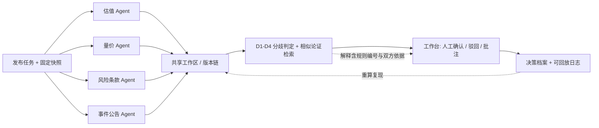

# 本科生毕业设计（论文）开题报告

**学　　校**：中南大学
**正式题名**：不预测涨跌，只核验过程：面向证券决策场景的多智能体可核验协同原型的设计与实现
**副　　题**：「没有回放，就还是演示」——从多角色观点卡、分歧提示到人工确认与对照实验
**学　　院**：【待补】
**专　　业**：计算机（本科）
**学生姓名**：【待填】
**学　　号**：【待填】
**指导教师**：黎方正
**日　　期**：【待填】
**版　　本**：v1.0（E 线，与 D 线「多智能体冶金工程设计协同」共用评测规范）

> **合规声明（首页必备）**：本报告为本科毕业设计开题材料，**不构成任何投资建议，不涉及证券投资咨询业务**。文中所有标的、行情、公告、条款与数值均为虚构教学样例，不对应任何真实证券、真实账户或真实交易；系统不接券商或行情实时接口，不做实盘或自动下单，不面向真实用户、不发布上线。此声明须同时出现在论文首页与答辩演示首页。

**命名口径**：全文不使用「交易 / 策略 / 收益 / 选股 / 智能投顾 / 系统 / 平台」作为课题定位词；统一使用「证券决策场景 / 决策样例任务 / 多智能体协同原型 / 可核验交付 / 决策档案」。出现「证券」二字时须紧跟边界说明：虚构标的、固定快照、不构成投资建议。

---

## 纲领：开题三问与书面回答

指导组要求开题时钉死三问，并在研究内容与验收中可追踪回答。本版逐条正面作答，作为全文纲领；3.3 节给出三问与研究内容、验收条款的追踪表。

| 三问 | 书面回答（锁定口径） |
|---|---|
| ① 各 Agent 的输入与输出分别是什么 | 输入＝固定快照（`snapshot_id` + 数据时点 + 数据哈希）、预置条款与公告库、共享工作区当前版本、上一回合的分歧与待定项清单；输出＝一份**结构化观点卡 JSON**（抽象立场、claim 参数表、依据条款、快照 ID、版本号、模型元信息），落盘为文件而非停留在对话。四类角色各有独立输入视图、工件模板与日志，不得只换提示词人设。 |
| ② 分歧与待定项如何被发现，并如何交由人或仲裁处理 | 由**类型化规则 D1–D4** 在结构化 claim 上确定性计算得出（见 4.4），不依赖模型自述；每条分歧输出「命中规则编号 + 双方 claim 与依据条款 + 快照 ID + 卡片版本」。处置统一交**工作台上的真人**做确认 / 驳回 / 批注；系统可给确定性优先级作为**建议**，但**不设仲裁 Agent**，以保证协商链路完整可回放。 |
| ③ 用哪一套（或哪几套）样例工程证明闭环成立 | 用 8–12 个虚构标的决策样例任务（固定快照 + 背景材料），每套含四类角色观点卡模板、≥12 条人工埋点分歧（D1/D2/D3 各 ≥4）、≥6 组相似论证对及 `golden.json` 标准答案；以 G1 多角色 / G2 单 Agent / G3 纯人工三组对照，证明「提案—分歧/相似提示—人工确认—决策档案」闭环成立。 |

**可证伪的研究问题**：在固定快照的虚构决策样例上，采用「角色化多智能体提案 + 类型化分歧检测 + 人在回路确认」的协同编排，是否比单 Agent 串行与纯人工表单**发现更多预置分歧**（分歧发现率更高）、**依据更可回溯**，且**不显著增加人工负担**（确认回合数与人工修改次数不显著上升）？

---

## 一、选题依据与意义

### 1.1 背景

随着人工智能辅助决策逐步进入工程教育与原型研发场景，复杂决策活动正从单点工具调用转向人机协同的流程化作业。证券决策场景天然具有**多专业并行**特征：基本面与估值、量价与技术面、风险条款、事件与公告往往由不同角色分别研判，各自依据不同快照、不同条款，形成版本并行、约束交叉与**分歧发现滞后**的突出矛盾——某一角色更新假设后，与其他角色的不相容往往要到汇总评审时才被察觉，而此时依据已散失、版本已分叉。

多智能体技术为「多角色并行提案 + 自动发现交叉约束」提供了新的可能，但也带来新的风险：若各 Agent 只是换人设的自由文本生成，分歧由模型自述、结果不可复现，系统就退化为演示界面，无法作为工程证据。本课题因此把**可计算、可复现、可证伪**作为立题前提，而非把「跑出一个多 Agent 对话」当作目标。

### 1.2 问题界定与四步降维

本课题以「多智能体分工完成虚构证券决策样例任务」为切口，建设面向证券决策场景的多智能体可核验协同原型：以工作台为人机界面，组织多角色智能体在共享工作区中提出观点卡，对分歧与相似论证给出可解释提示，并经人工确认形成决策档案。

**按字面做「面向证券交易的多智能体系统」不能作为本科毕设课题**，须先完成四步降维：

| # | 换什么 | 从 | 到 |
|---|---|---|---|
| ① | 研究对象 | 交易执行与策略收益 | 多角色决策过程、分歧发现与证据链 |
| ② | 场景 | 真实市场 / 实盘 / 实时行情接口 | 固定历史快照 + 虚构标的 + 离线样例任务 |
| ③ | 产出 | 买卖信号、下单、目标价、仓位 | 结构化观点卡 + 类型化分歧提示 + 人工确认 + 决策档案 |
| ④ | 判据 | 收益率、胜率、夏普、模拟盘盈亏 | 分歧发现率、误报率、依据可回溯率、重跑一致率、人工负担 |

**第 ④ 步是分水岭**：只要验收指标里还保留收益类指标，课题就仍是量化策略题，评审必然追问未来函数、交易成本、幸存者偏差与过拟合，而这些既不是计算机本科毕设能答好、也不该由它来答的问题。降维之后，研究对象变为**设计/决策协作流程本身**（角色协议、分歧判定、人工确认、证据留存），不是证券机理、不是行情预测、不是交易执行。

### 1.3 定位边界

本课题定位为**可运行的教学 / 科研原型与过程证据**，不替代任何投研流程，不面向真实用户，不以真实市场表现为目标。题名中的「原型」指可复现的软件原型，不指投研平台或交易系统。样例任务虚构但结构完整，用于承载流程验证。

### 1.4 意义

- **方法意义**：把「多智能体协同是否有效」从一个演示问题变成可用评测集判定的实验问题，为本科阶段 LLM 应用类课题提供可复制的证据规范。
- **教学意义**：与课程群「筑基—赋能—跃升」叙事一致，训练协议设计、评测集构造与责任边界论证能力，即 AI 时代稀缺的「把智能体产出变成可核验交付物」的工程能力。与 D 线（冶金工程设计协同）构成「同一方法、两个领域」的横向案例对。
- **工程意义**：共享工作区 + 版本对照 + 可解释提示 + 人工确认 + 决策档案的组合，可迁移到其他多专业协同研判场景。

### 1.5 合规声明与命名口径

| 约束 | 具体口径 |
|---|---|
| 业务性质 | 教学原型，**不构成投资建议，不涉及证券投资咨询**；不代客理财、不荐股、不面向真实用户、不发布上线 |
| 数据 | 虚构标的与合成快照；若引用公开历史数据须注明来源、用途限于输入快照，且不得用于生成建议；不使用账户数据、不编造行情 |
| 输出 | 观点卡的 `stance` 只到抽象立场标签；不得出现买入、卖出、目标价、仓位、下单指令或任何可执行投资建议 |
| 判据 | 全部为过程指标；**不以收益率、胜率、夏普比率、最大回撤、模拟盘盈亏、策略有效性作为验收指标，也不写入结论** |
| 标注 | 报告、论文、演示首页均标注「不构成投资建议」；解释输出模板末尾附同样声明 |

---

## 二、国内外研究现状

> **文献说明**：本节按六个方向给出可核对的检索方向与评述框架，具体文献条目【待补】。学生须按学院格式补全 ≥15 篇真实文献，**禁止编造 DOI、卷期、页码、法规条文编号或伪引文**；每条入选文献须先核对来源再写入第十节正式列表。

### 2.1 多智能体协同与角色协议

已有工作围绕角色分工、协商协议与共享状态展开：一类以对话式角色扮演组织多 Agent 回合，一类以编排图或状态机显式定义节点与转移，还有一类以消息总线解耦各 Agent。三者共同为「多角色提出片段—协商分歧」提供方法参照，但多数以通用任务（代码生成、问答、写作）为评测场景，**少有把输出约束为结构化工程工件、并以预置分歧集做召回评测**的做法。本课题采用「显式编排 + 结构化观点卡」路线，回避纯对话式协同中输出不可比、不可回放的问题。

检索方向：多智能体协作框架与角色协议、Agent 编排与状态机、工具调用编排、共享状态与黑板模型。

### 2.2 人在回路与人工确认

人在回路研究强调在关键决策点保留人类否决权，并把人工反馈记录为可审计数据。协同研判场景下，人对分歧的确认或驳回本身即是高价值标注。本课题把人工确认设为**主路径必经环节**而非可选开关，并要求保留确认动作、批注与前后版本快照，使「人做了什么」可单独成证。

检索方向：人在回路机器学习、AI 辅助决策的人机责任边界、可审计交互日志、人工反馈留痕。

### 2.3 语言模型在金融文本与研判辅助中的应用及局限

已有工作多集中于金融文本理解、公告与研报信息抽取、情绪与事件标签、问答与摘要，以及针对 LLM 输出可靠性、幻觉与一致性的评测讨论。这些工作说明「让模型读材料、给依据」是可行的，也普遍指出**自由文本结论难以核验、难以复现、难以归因**的问题。本课题不沿用「让模型给判断结论」的路线，而是把模型产出限定为**带依据条款与快照 ID 的结构化 claim**，并把「判断」交给确定性规则与真人确认；收益预测、策略生成与荐股类工作**不在本课题范围内，也不作为对照基线**。

检索方向：金融文本信息抽取、LLM 事实一致性与幻觉评测、可核验证据生成、AI 辅助决策的合规与责任边界讨论。

### 2.4 分歧检测、一致性维护与版本对照

软件工程与文档协同中的差异比较、冲突标注（同键异值、区间不相交、约束互斥）可迁移到**结构化观点对照**；产品生命周期管理与并行工程领域讨论多专业一致性维护与变更传播。案例推理与相似检索可对历史或并行论证做提示。已有做法多面向代码或文本，结构化 claim 上的类型化分歧判定仍需自行定义。本课题据此给出 D1–D4 规则集（见 4.4），并只吸收「共享工作区 + 版本对照」思想，不实现任何业务审批流或风控引擎。

检索方向：结构化差异比较、约束冲突检测、并行工程一致性维护、案例推理与相似检索。

### 2.5 可解释提示、对照实验与可复现性

可解释性研究区分「模型自述式解释」与「证据可回溯式解释」，本课题明确采用后者：解释 = 命中规则编号 + 双方 claim 与依据条款 + 快照 ID + 卡片版本，可在不调用模型的情况下重算复现。LLM 应用类课题常见缺陷是只比「有无 AI」，不控制模型、预算与评测集，导致结论不可归因；本课题据此设置三组编排与公平性约束（见 5.3）。可复现性方面，固定生成条件、全量日志与录制回放已是工程实践共识。

检索方向：可解释 AI 与证据回溯、LLM 应用评测基准、消融与对照实验设计、确定性回放与可复现工程实践。

### 2.6 现状评述与本科课题空间

综合来看，**把多智能体角色协议、工作台人机界面与可解释分歧/相似提示结合，并在虚构但结构完整的证券决策样例上跑通可评测闭环**，仍有明确的本科课题空间：技术门槛不依赖真实市场接口与授权数据，工作量可通过样例规模调节，创新性落在协同机制与证据规范上，不落在收益表现或机理突破上。相较于容易被质疑「是否只是换了个领域做演示」的做法，本课题以预置分歧评测集与三组对照给出可证伪判据，是其立题依据的核心。

---

## 三、研究目标、内容与关键问题

### 3.1 总目标

交付一个**可按 README 运行、结果可复现**的多智能体可核验协同原型，覆盖主路径「发布任务 → 多 Agent 出观点卡 → 分歧/相似提示 → 人工确认 → 决策档案」，并至少形成 ≥1 组三组对照用例、≥3 个可解释用例、完整可回放日志与决策档案；全程不输出任何可执行投资建议。

### 3.2 研究内容

| 编号 | 内容 | 关键产出 | 回应 |
|---|---|---|---|
| R1 | 角色智能体与协议 | 估值、量价、风险条款、事件公告四角色的职责边界、输入视图、观点卡 schema、消息与交互协议；各 Agent 独立输入输出与独立日志 | 三问① |
| R2 | 快照层、共享工作区、版本与待定项 | 带哈希的固定快照、卡片版本链（`parent_version`）、待定项看板、每回合 JSONL 落盘、录制回放 fixture | 三问② |
| R3 | 分歧与相似论证的可解释提示 | D1–D4 类型化规则集、相似论证 Top-k 检索、结构化解释输出模板；禁止模型自述式黑盒演示 | 三问② |
| R4 | 人工确认闭环 | 工作台确认 / 驳回 / 批注接口、处置记录、决策档案生成器；不设仲裁 Agent | 三问② |
| R5 | 样例任务包、评测集与对照实验 | 8–12 套虚构决策样例 + `golden.json` 标准答案 + G1/G2/G3 三组对照 | 三问③ |

五项内容均**不要求真实行情接口、不要求真实标的、不要求收益回测、不要求任何交易执行**。

### 3.3 三问—内容—验收追踪表

| 开题三问 | 对应研究内容 | 对应验收条款 | 可追踪证据 |
|---|---|---|---|
| ① 各 Agent 的输入输出 | R1 | 阻断项②：少于 2 个角色 Agent，或仅换人设无独立输入输出与日志 | 四套观点卡模板、每角色独立 JSONL 日志 |
| ② 分歧如何发现、交谁处理 | R2 / R3 / R4 | 阻断项③：无分歧或协商可回放记录；阻断项①：主路径断裂 | 分歧明细表、回放 fixture、人工确认记录 |
| ③ 用哪几套样例证明闭环 | R5 | 阻断项④：无 ≥1 组对照用例；阻断项⑤⑥：写成实盘/收益/投资建议，或使用来源不明数据 | `golden.json`、对照实验报告、合规声明专节 |

### 3.4 关键问题与难点

| 难点 | 说明 | 攻克路径 |
|---|---|---|
| D1 分歧的形式化 | 若分歧由 LLM 自由判断，「可解释」退化为模型自述，且无 ground truth，所有指标失效 | 观点卡结构化 + D1–D4 规则集 + 人工埋点评测集；解释由规则与证据生成，不调用模型 |
| D2 可复现性 | 多 Agent 多回合 LLM 调用天然随机，与「按 README 跑通」「可回放」「对照可复现」直接冲突 | 固定模型版本与 `temperature=0`/seed、全量 JSONL、录制回放 fixture、`mock_llm` 离线兜底 |
| D3 对照的公平性 | 不控制模型与预算，结论会被质疑「只是多花了算力」 | 同样例、同基座、同 token/回合预算上限、同评测集、同评审者，只变编排方式 |
| D4 范围克制与合规表述 | 学生最容易忍不住加「回测收益曲线」或「模拟盘」，一加即越界且变味 | 开题即锁定红线与命名口径；中期检查复核范围；阻断项⑤一票否决 |

**其中 D1、D2 是隐形难点，D4 是本课题相对 D 线新增的独有难点**：表面看是搭建多 Agent 演示，实际难度集中在评测体系、证据链与合规边界的克制上。这也是本课题与「模型训练类」「量化策略类」毕设在能力要求上的根本差别。

---

## 四、研究方法与技术路线

### 4.1 总体架构

采用「编排/消息总线 + 工作台 HMI + 版本对照 + Agent 工具（条款与公告检索）」四层架构。智能体侧按角色协议生成结构化观点卡并调用检索工具；工作台侧负责任务发布、待定项与确认操作；对照模块负责版本差异与分歧/相似呈现；证据层负责全量日志与回放。

| 层 | 职责 | 关键约束 |
|---|---|---|
| A 角色 Agent 层 | 四角色按模板产出观点卡，调用条款/公告检索工具 | 输出必须落盘 JSON；角色 ≥2 且各有独立输入输出与日志；不得输出投资建议 |
| B 编排与消息层 | 组织回合顺序、广播版本快照与分歧清单 | 回合可编号、消息可序列化；不引入隐式 LLM 仲裁 |
| C 快照、工件与版本层 | 固定快照管理、`parent_version` 链、待定项看板、D1–D4 判定 | 分歧判定为确定性计算，与模型调用解耦；快照带 `snapshot_id` 与哈希 |
| D 工作台与证据层 | 人工确认/驳回/批注、决策档案、JSONL 日志、replay fixture | 人工动作留痕；档案每条分歧可由原始观点卡重算复现 |

### 4.2 快照与条款层

所有输入材料在开题后一次性固定，运行期不再变化：

| 项 | 规格 |
|---|---|
| 行情快照 | 合成时序或注明来源的公开历史片段，`snapshot_id` + 数据时点 + 数据哈希；**不接实时接口** |
| 公告与条款库 | 人工预置的虚构条目，编号可核对；含互斥条款对表，供 D3 判定 |
| 用途限制 | 仅作为角色 Agent 的输入素材，不得用于生成任何买卖或仓位建议 |

### 4.3 观点卡 schema

所有 Agent 输出必须落盘为结构化观点卡，不得只存在于对话上下文中：

```
opinion_card = {
  task_id, role, card_id, version, parent_version,
  snapshot_id,             // 固定快照：数据时点 + 数据哈希
  stance,                  // 抽象立场：支持 / 反对 / 存疑
  claims: [ { key, unit, value, range: [low, high], clause_ref, evidence_ref } ],
  rationale,               // 依据：条款号 / 公告条目 / 快照片段
  created_at,
  llm_meta                 // model, version, temperature, seed, prompt_hash
}
```

| 角色 | 职责 | 典型 claim（均为虚构样例参数） |
|---|---|---|
| 基本面 / 估值 | 估值区间与财务约束 | 估值区间、增速假设、口径说明 |
| 量价 / 技术面 | 趋势与波动描述 | 波动区间、量能区间、形态标签 |
| 风险条款 / 合规 | 只查预置条款一致性，不做风控决策 | 集中度上限、条款互斥对、披露要求 |
| 事件 / 公告 | 基于固定公告快照给依据 | 公告条目编号、事件类型、时点 |

**合规硬约束**：`stance` 只能是抽象立场标签；`claims` 中所有数值均为虚构样例参数；**观点卡中不得出现买入、卖出、目标价、仓位、下单指令或任何可执行投资建议**。共享工作区即一组按 `card_id + version` 组织的文件，版本链由 `parent_version` 显式给出，避免依赖内存状态。

### 4.4 分歧类型化定义（D1–D4）

| 编号 | 类型 | 判定条件 | 处置 |
|---|---|---|---|
| D1 | 同标的异立场 | 不同角色对同一虚构标的给出不同 `stance`，且置信区间不相交 | 生成分歧项，附双方观点卡与依据，交人工确认 |
| D2 | 区间不相交 | 两角色对同一 `key` 的 `range` 交集为空 | 同上 |
| D3 | 条款互斥 | 双方 `clause_ref` 指向人工预置的互斥条款对 | 同上 |
| D4 | 口径或时点不一致 | `snapshot_id` 不同、复权或单位口径不同且未换算 | 记为「待定项」，不判分歧，先要求澄清 |

**分歧判定全部为确定性规则计算**，与 LLM 调用解耦：给定同一组观点卡，不调用模型也能重算出完全相同的分歧集合。这是「可解释」「可回放」「重跑一致率」三项要求共同的前提。

### 4.5 相似论证检索与可解释输出

相似提示对 `claims` 做字段 Jaccard 或参数向量距离，取 Top-k 返回，并附「命中字段 + 双方依据」。解释输出采用固定模板，禁止自由文本自述：

```
分歧 D2 @ claim: valuation_range
  估值角色: [18, 24]    依据 V-04   快照 SNAP-003   卡片 C-估值-v2
  风险角色: [<= 16]     依据 R-11   快照 SNAP-003   卡片 C-风险-v1
  判定: 区间交集为空 -> 命中规则 D2
  处置: 交人工确认（确认 / 驳回 / 批注），不设仲裁 Agent
  声明: 以上数值为虚构样例参数，不构成投资建议
```

相似提示须可人工否决；被否决的提示连同理由一并记入日志，作为误报率统计与可解释用例素材。

### 4.6 仲裁机制

**仲裁 = 工作台上的真人**。系统可提供确定性优先级作为处置建议，但建议只是排序，不代替人的确认动作；**不设仲裁 Agent**，因为 LLM 仲裁会引入无法完整回放的隐式决策，直接顶到验收阻断项③。

### 4.7 主路径（固定）

| 步骤 | 环节 | 输入 | 输出 | 落盘证据 |
|---|---|---|---|---|
| 1 | 发布任务 | 任务书、虚构样例配置 | 任务实例、角色分配 | `task.json` |
| 2 | 多 Agent 出观点卡 | 版本快照 + 分歧清单 | ≥2 份角色观点卡 | `cards/*.json` + 回合日志 |
| 3 | 分歧/相似提示 | 全部观点卡 | 类型化分歧表 + Top-k 相似 | `disagreements.json` + 解释文本 |
| 4 | 人工确认 | 分歧表 | 确认/驳回/批注记录 | `decisions.jsonl` |
| 5 | 决策档案 | 以上全部 | 版本对照与处置档案 | `report.md` / `report.html` |

任一环节缺失即视为主路径断裂，与验收阻断项①对齐。



技术路线按「先固定快照与评测集 → 再接单 Agent → 再扩多角色 → 最后做对照与回放」的顺序推进：**评测集先行**，避免先写系统再凑用例。

### 4.8 可复现与离线兜底

| 措施 | 具体做法 |
|---|---|
| 固定生成条件 | 记录并固定 model + version；`temperature=0`；固定 seed；记录 `prompt_hash` |
| 全量留痕 | 每回合 prompt、模型输出、工具调用、观点卡版本、人工动作写入 JSONL |
| 录制回放 | `replay/` 保存一次真实运行的完整 fixture（含模型应答），可脱网重放 |
| 离线兜底 | `mock_llm` 开关：固定应答或本地小模型替代商用 API，保证主路径仍可跑通 |
| 双命令 README | `run`（在线真实调用）与 `replay`（离线回放）两条命令都必须跑通主路径 |
| 重算校验 | 决策档案中的每条分歧，须能从原始观点卡在不调用模型的情况下重算得出 |

### 4.9 可视化与本地惯例

工作台若展示行情快照，只展示合成或已注明来源的固定片段，不展示实时行情、不展示任何买卖信号；**涨跌配色遵循 A 股惯例（涨红跌绿）**，金额一律使用 ¥。所有面板与导出文件页脚固定显示「虚构教学样例，不构成投资建议」。

---

## 五、实验设计与评价指标

### 5.1 样例任务最小规格

| 项 | 规格 |
|---|---|
| 决策样例任务 | 8–12 个虚构标的任务，固定快照 + 背景材料 |
| 观点卡模板 | 估值 / 量价 / 风险条款 / 事件公告 4 套，字段与 schema 一致 |
| claim 条目 | 每套 ≥20 条，覆盖四类角色 |
| 埋点分歧 | 每套 ≥12 条，D1/D2/D3 各 ≥4，写入 `golden.json` |
| 相似论证对 | 每套 ≥6 组，标注命中字段 |
| 标准答案 | `golden.json`：分歧清单、类型、涉及卡片、建议处置 |
| 数据来源 | 全部虚构或明确标注来源的公开历史快照；不使用账户数据，不用于生成建议 |

### 5.2 评测集构造

先由人工在样例中**埋点**已知分歧与相似论证对，形成 `golden.json`；再让各编排方式独立跑同一任务，以其输出的分歧集合与标准答案比对。埋点须覆盖三类规则，并特意设置若干「看似分歧实则口径或时点不同」的 D4 情形，用于检验误报。

### 5.3 对照实验设计

| 组别 | 编排方式 | 说明 |
|---|---|---|
| G1 | 多角色协同（本系统） | 四角色并行提案 + 类型化分歧检测 + 人工确认 |
| G2 | 单 Agent 串行 | 同一模型依次扮演四角色，串行产出观点卡，共用判定模块 |
| G3 | 纯人工表单 | 结构化表单人工填写，无 LLM 生成，共用判定模块 |

**公平性控制**：同一套样例、同一基座模型、同一 token/回合预算上限、同一 `golden.json`、同一人工评审者；三组只变「编排方式」。分歧判定模块三组共用，确保差异只来自提案与协同环节，而非判定口径。**收益预测、策略生成、荐股类基线不纳入对照**，避免课题越界。

### 5.4 评价指标（全部为过程指标）

| 指标 | 定义 | 用途 |
|---|---|---|
| 分歧发现率 | 检出的预置分歧数 / 预置分歧总数，按 D1/D2/D3 分列 | 主要有效性指标 |
| 误报率 | 非预置分歧被报出的条数 / 总报出条数 | 检验 D4 与规则严谨性 |
| 依据可回溯率 | 每条提示可追溯到 `clause_ref` / `snapshot_id` / 卡片版本的比例 | 可核验性核心指标 |
| 相似论证命中率 | Top-k 中命中预置相似对的组数 / 预置相似对总数 | 相似检索有效性 |
| 重跑一致率 | 同输入重跑，分歧集合与决策档案一致的比例 | 可复现性硬指标 |
| 人工负担 | 确认回合数、人工修改次数、端到端耗时 | 检验「不显著增加负担」 |
| 提示采纳率 | 人工采纳的提示数 / 提示总数 | 可解释性间接指标 |

**明确排除的指标**：收益率、胜率、夏普比率、最大回撤、模拟盘盈亏、策略有效性、预测准确率。**一律不作为验收指标，也不写入论文结论。**

结论表述必须克制：若 G1 在发现率与依据可回溯率上优于 G2/G3 且人工负担不显著上升，则支持协同编排有效；**若差异不显著，须如实报告并分析原因，不得强行宣称优势**。

### 5.5 可解释用例集合（≥3）

| 用例 | 覆盖 | 验收要点 |
|---|---|---|
| E1 | D1 同标的异立场 | 解释含双方 `stance`、置信区间、命中规则、卡片版本 |
| E2 | D2 区间不相交 | 解释含双方区间、交集为空的计算、依据条款与快照 ID |
| E3 | D3 条款互斥 | 解释含互斥条款对编号与预置互斥表条目 |
| E4（建议） | D4 误报被人工驳回 | 记录驳回理由，用于误报率与边界讨论 |

每个用例须能从原始观点卡重算复现，附人工确认记录与「不构成投资建议」标注，禁止「黑盒演示」式通过验收。

### 5.6 回放与重跑一致性验证

对同一 `task_id` 分别执行 `run` 与 `replay`，比对分歧集合、决策档案与解释文本；再由评审者在**不启动模型**的情况下，用原始 `cards/` 重算分歧表，与档案逐条核对。三者一致方可判定重跑一致率达标。

---

## 六、进度安排

> 具体日期【待学院节点回填】；下表周次为建议排布，阶段目标与交付物为锁定项。

| 阶段 | 建议周次 | 阶段目标 | 交付物 | 判定 |
|---|---|---|---|---|
| 开题阶段 | 第 1–3 周 | 钉死角色划分、交互协议、样例选型与合规红线；书面回答开题三问；完成开题报告修订 | 修订版开题报告、观点卡 schema、样例规格表、合规声明 | 三问有书面答案；红线与命名口径锁定 |
| 评测集先行 | 第 4–6 周 | 完成固定快照与条款库、8–12 套样例、埋点分歧与 `golden.json`；实现 D1–D4 判定与解释模板 | 快照包、样例包、规则模块、单元测试 | 不调用模型即可重算出标准答案 |
| 中期阶段 | 第 7–9 周 | 至少两个角色 Agent 跑通「提案—分歧—确认」，保留日志与可回放记录 | 原型 v0.5、JSONL 日志、回放 fixture | 对应中期检查；阻断项③提前自查；范围复核 |
| 实现阶段 | 第 10–14 周 | 完成可运行原型与 README；实现 ≥3 个可解释用例；完成 ≥1 组三组对照 | 原型 v1.0、README（run/replay）、对照实验记录 | 主路径 5 步全部可跑通 |
| 论文与答辩 | 第 15–18 周 | 整理角色权限与流程说明、决策档案、红线专节与合规声明；完成论文与答辩 | 论文、答辩材料、三分责任表 | 呼应阻断项⑤⑥，专节写清责任边界 |

---

## 七、预期成果与验收

### 7.1 预期成果

1. 可按 README 运行的原型系统（含 `run` 与 `replay` 两条主路径命令）；
2. 角色权限与流程说明（四角色职责、输入输出、协议）；
3. 固定快照与条款库（含 `snapshot_id` 与哈希、互斥条款对表）；
4. 版本 / 分歧对照决策档案与可回放日志；
5. ≥3 个可解释用例（含解释模板与重算记录）；
6. ≥1 组 G1/G2/G3 三组对照用例及过程指标表；
7. 样例任务包（8–12 套 + `golden.json`）；
8. 项目 README、关键日志与回放材料；
9. 论文中的红线专节、合规声明与三分责任表。

### 7.2 验收阻断项（出现任一项即验收不通过）

1. 原型按 README 跑不通，或「发布任务→多 Agent 出观点卡→分歧/相似提示→人工确认→决策档案」主路径断裂；
2. 少于 2 个角色 Agent，或仅换人设无独立输入输出与日志；
3. 无分歧或协商可回放记录；
4. 无 ≥1 组多智能体 vs 单 Agent / 纯人工的对照用例；
5. **把实盘、自动下单、收益或策略有效性写成已完成，或输出可执行投资建议**（本课题专属，一票否决）；
6. 使用未说明来源的行情数据，或样例中出现真实标的与实际买卖建议；
7. 缺失首页「不构成投资建议」合规声明，或论文缺红线专节。

### 7.3 主路径判定表

| 判定点 | 通过条件 | 证据位置 |
|---|---|---|
| 发布任务 | `task.json` 生成，角色分配明确，快照 ID 固定 | `tasks/` |
| 多 Agent 出观点卡 | ≥2 个角色各产出独立观点卡，日志可区分，无投资建议字段 | `cards/` + `logs/` |
| 分歧/相似提示 | 输出含规则编号、双方 claim 与依据、快照 ID | `disagreements.json` |
| 人工确认 | 每条分歧有确认/驳回/批注记录 | `decisions.jsonl` |
| 决策档案 | 每条分歧可由原始观点卡重算复现，含合规声明 | `report.md` + `replay/` |

---

## 八、可行性分析与风险对策

### 8.1 可行性

| 维度 | 判断 |
|---|---|
| 技术可行性 | 编排、结构化工件、规则判定、Web 工作台均为成熟工程手段；不涉及模型训练、不涉及交易执行 |
| 数据可行性 | 快照、标的、公告、条款全部虚构且结构完整，无需行情授权、无需账户数据、无需审批与脱敏 |
| 合规可行性 | 不接接口、不做实盘、不输出投资建议、不发布上线；以首页声明与红线专节把边界写死，课题性质为教学原型 |
| 条件可行性 | 笔记本即可开发；通过 `mock_llm` 与 `replay` 保证无网络、无 API 经费时仍能跑通主路径 |
| 能力匹配 | 适合协议设计、工程化与论证能力较强、能耐心构造评测集的学生；不适合以模型训练或量化策略为主攻方向的学生 |
| 工作量可伸缩 | 下限：规则 Agent + 8 套样例 + 录制回放；上限：条款 RAG 依据检索、更细分歧类型、更完整量化对照 |

### 8.2 风险与对策

| 风险 | 影响 | 对策 |
|---|---|---|
| 合规表述被误读为荐股或投研产品 | 开题被否、答辩受阻 | 首页与演示首页固定声明；命名口径锁定；输出字段白名单；阻断项⑤⑥一票否决 |
| 范围膨胀，学生想加回测收益曲线或模拟盘 | 课题变味且越界 | 开题即锁定红线；中期检查复核范围；收益类指标明确排除 |
| LLM 输出不确定，答辩现场跑不出同样结果 | 触发阻断项①③ | 固定 `temperature=0`/seed、全量 JSONL、replay fixture、答辩演示走 `replay` |
| 商用 API 费用 / 限流 / 断网 | 原型跑不通 | `mock_llm` 兜底、限制回合预算、README 双命令 |
| 样例与埋点主观，评测集被质疑 | 结论不可信 | `golden.json` 公开、埋点按 D1/D2/D3 分层、预留样例做泛化检查 |
| 对照不公平，被质疑「只是多花算力」 | 结论不可归因 | 5.3 公平性控制；三组共用判定模块 |
| 格式不合学院要求被退回 | 影响开题节点 | ≥15 篇真实文献按学院格式、标题层级与页码目录、正文与附录 B 分离 |

---

## 九、创新点与红线

### 9.1 创新点

1. **面向证券决策样例任务的多智能体可核验协同机制**：以工作台为人机界面，把多角色提案、类型化分歧/相似可解释提示与人工确认闭环组织为可运行原型，产出决策档案而非投资建议；
2. **分歧判定的确定性化**：把「可解释」从模型自述改为「规则编号 + 双方 claim + 依据条款 + 快照 ID + 版本」的证据回溯，使解释可在不调用模型的情况下重算；
3. **面向 LLM 应用类课题的合规证据规范**：预置分歧评测集 + 三组公平对照 + 录制回放 + 过程指标，把「AI 有没有用」变成可证伪的实验问题，同时把收益判据彻底移出验收体系。

创新表述克制为「协同原型与过程方法」，**不夸大为行情预测能力、策略有效性或投研平台级系统**。

### 9.2 红线

1. 不接券商或行情实时接口，不做实盘或模拟盘自动下单，不面向真实用户、不发布上线；
2. **不输出买入、卖出、目标价、仓位等可执行投资建议**，所有标的与数值为虚构样例；报告、论文、演示首页标注「不构成投资建议」；
3. 不以收益类指标验收，不声称策略有效、不声称预测能力，不从事证券投资咨询、不代客理财；
4. 不使用未授权或未说明来源的行情数据，不编造行情、法规条文编号、文献、DOI 与卷期；
5. 不设隐式 LLM 仲裁，不把模型自述当作可解释证据；
6. 论文与答辩材料须**专节**写清「多智能体做了什么 / 人做了什么 / 红线没做什么」。

### 9.3 三分责任表（论文与答辩必备）

| 多智能体做了什么 | 人做了什么 | 明确没做什么 |
|---|---|---|
| 按角色协议产出结构化观点卡，附条款与快照依据 | 编写任务书、条款库、公告库与虚构快照 | 未做行情预测、未生成买卖建议 |
| 并行提出可能不相容的 claim，形成待比较方案集 | 埋点预置分歧、维护 `golden.json` | 未接券商接口、未做实盘或自动下单 |
| 输出可由规则重算的分歧解释与版本链 | 对每条分歧确认/驳回/批注，审定对照结论 | 未声称策略有效、未用收益指标验收 |
| 全程留痕（prompt、输出、工具调用、卡片版本） | 复核回放一致性，签署验收与合规声明 | 未让模型充当仲裁者，未把自述当证据 |

---

## 十、参考文献与补齐要求

**正式参考文献条目【待补】，须 ≥15 篇，按学院格式著录。** 学生按下列方向检索与阅读，每条入选文献须先核对来源（出版社 / 会议 / 期刊 / 官方仓库 / 权威综述）后再写入，**禁止编造 DOI、卷期、页码、法规条文编号或伪引文**。

| 序号 | 检索方向 | 建议关键词 | 来源类型 |
|---|---|---|---|
| 1 | 多智能体协同与角色协议 | multi-agent collaboration, role protocol, agent orchestration | 综述、框架官方文档、顶会论文 |
| 2 | 人在回路与人工确认 | human-in-the-loop, human oversight, audit trail | 综述、人机交互研究 |
| 3 | 金融文本理解与信息抽取 | financial NLP, information extraction, document understanding | 会议 / 期刊论文 |
| 4 | LLM 事实一致性、幻觉与证据回溯 | factuality, hallucination, evidence-grounded explanation | 评测基准与综述 |
| 5 | 结构化差异、冲突检测与一致性维护 | structured diff, constraint conflict detection, consistency maintenance | 软件工程 / 协同编辑论文 |
| 6 | 相似论证与案例检索 | case-based reasoning, similarity retrieval | 设计方法学 / 检索论文 |
| 7 | LLM 应用评测与对照实验 | LLM evaluation benchmark, ablation study | 评测基准论文 |
| 8 | 可复现性与回放工程实践 | reproducibility, deterministic replay, logging | 工程实践文献 |

**著录格式示范（占位，不得照抄为真实文献）**：

```
[1] 作者. 题名[文献类型标识]. 出处, 年份, 卷(期): 起止页码. （须核对后填写）
[2] 作者. 题名. 会议名称, 年份: 页码. （须核对后填写）
```

本项目此前所有开题报告均遵循「只给检索方向、严禁编造引文」的约定，本版保持一致。

---

## 附录 A：交付目录结构与 README 约定

```
project/
  README.md                    # run / replay 两条命令，主路径与验收自查表，首页合规声明
  tasks/                       # task.json，虚构决策样例任务书
  snapshots/                   # 固定快照 + snapshot_id + 数据哈希 + 条款/公告库
  schema/opinion_card.json     # 观点卡 schema 与四角色模板
  rules/disagreements_d1_d4.md # 分歧规则集、互斥条款表、输出字段白名单
  samples/                     # 8-12 套样例 + golden.json
  agents/                      # 四角色实现 + mock_llm
  workbench/                   # 工作台 HMI：确认/驳回/批注（涨红跌绿、¥、页脚声明）
  cards/                       # 各版本观点卡（parent_version 链）
  logs/                        # 每回合 JSONL：prompt/输出/工具调用/人工动作
  replay/                      # 一次真实运行的完整 fixture
  report/                      # 决策档案、过程指标表、对照实验记录
```

README 须写明：环境依赖、如何获取（或不获取）模型密钥、如何运行 `run`、如何离线运行 `replay`、主路径五步自查表、7 条验收阻断项自查清单，以及首页「不构成投资建议」声明。

---

## 附录 B：与 D 线的同构映射（课程案例对，教师核对用，正式提交可删）

| D 线：多智能体冶金工程设计协同 | E 线：证券决策场景可核验协同 | 复用程度 |
|---|---|---|
| 工艺 / 热工 / 物料 / 标准四角色 | 估值 / 量价 / 风险条款 / 事件公告四角色 | 协议与日志框架整体复用 |
| 工件 artifact（参数表 + 条款） | 观点卡 opinion_card（claim + clause_ref） | schema 结构复用，字段换算 |
| 冲突 C1–C4 | 分歧 D1–D4 | 判定模块几乎原样复用 |
| 对照报告 | 决策档案 | 生成器复用 |
| 主路径五步、5 条阻断项、三分责任表 | 主路径五步、7 条阻断项、三分责任表 | 表格与验收流程复用 |
| 可复现方案（JSONL / replay / mock_llm） | 完全相同 | 整体复用 |
| 红线：不做真实 CAE / DCS / 出图 | 红线：不做实盘 / 自动下单 / 投资建议 / 收益验收 | **E 线新增，不可复用** |

两线并列构成「同一方法、两个领域」的课程案例对，可用于课程群横向对比教学；**E 线独有的一层是金融合规边界，也是开题时最需要指导组确认的部分**。

---

*本版为正式开题报告 v1.0。封面【待补/待填】字段、进度日期与参考文献须由学生按学院要求回填。全文未编造任何行情数据、法规条文编号、文献条目与实验结论；所有标的、快照、条款与数值均为教学虚构，不构成投资建议。*
