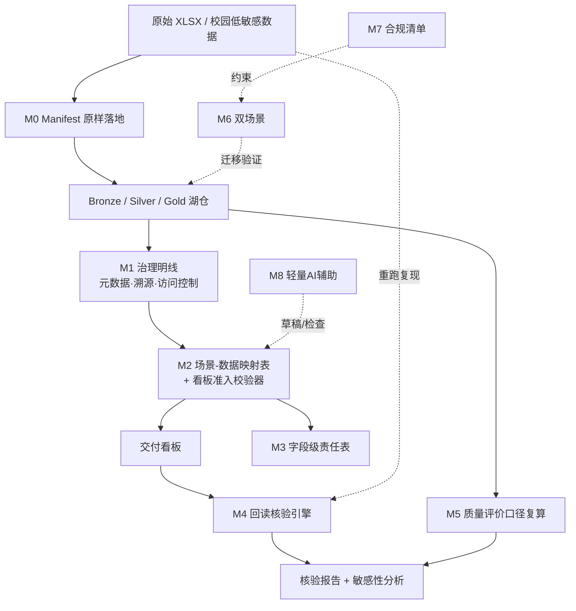
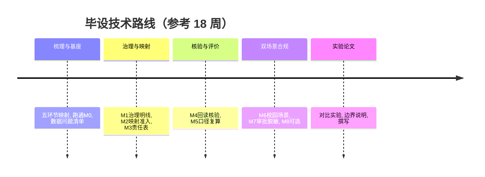

# 毕业设计开题报告

**课题名称**：「一数一源一责」可核验数据交付原型的设计与实现
**副标题**：面向数据基座课程——场景—数据映射、回读核验与质量评价口径复算
**课题来源**：课程建设 / 教学线培育选题（数据基座课程四段能力链）
**课题类型**：数据工程 + 软件原型（计算机 / 数据科学与大数据技术 / 软件工程）
**适用对象**：数据工程基础扎实、能独立完成流水线实现与实验验证的本科毕业生
**文档版本**：v1.0　整理日期：2026-11-05

---

## 一、选题依据与意义

### 1.1 课题背景

数据基座领域的实践通常被归纳为**采、存、治、用、评**五个环节。与之对照，本校数据基座相关课程已形成**四段能力链**：① 数据接入（Manifest、原样落地）② 湖仓分层（Bronze / Silver / Gold）③ 特征语料 ④ 交付看板。两者高度同构：采对应数据接入、存对应湖仓、用对应特征语料与交付看板。

但两处仍未打通：**「治」分散在元数据登记、溯源、访问控制等检查点中，未成为一条明线**；**「评」仅有 `dq_report` 质量报告，缺少可论证的质量评价维度**。同时，课程答辩要求「全链路叙事完整」「看板数字必须能从原始 XLSX 重跑复现」，这些要求长期停留在口头规矩层面，缺少可交付、可校验的证据形态。

另一方面，学生第一次面对 **29602 行带缺失、带非法时间戳的原始传感器数据**时，普遍存在「重模型、轻基座」的倾向。行业观察指出：**「智能体是树，数据中台是土」「模型可以一年一换，基座要用十年」**——AI 时代最先稀缺的，是能搭建并维护可靠数据流水线的人。

### 1.2 研究意义

- **教学意义**：把「数据基座文章理念 ↔ 课程四段能力链」的同构关系**显性化**，让「井里没水，抽上来的都是泥沙」从口号变成学生处理脏数据时的体感；把目标 4（团队角色）通过字段级责任表从口号变成产物。
- **方法意义**：在已有四段流水线之上增加一层**可核验 / 可追责 / 可论证的交付层**，把「全链路叙事完整」的答辩检查点转化为自动化证据。
- **课程群意义**：本题产出的干净特征表、映射表与口径规范，是后续「赋能」（第 4 学期数据分析挖掘开发实践）与「跃升」（第 5–6 学期多模态 / 综合应用实践）两级课程可复用的**交接接口**，可直接支撑培养方案课程链描述与申报材料论证。

### 1.3 立题支撑

本题依托已调整到位的课程内容与真实教学案例：
- **数据**：29602 行带缺失与非法时间戳的高炉原始传感器 XLSX，可完整重跑复现；
- **产物**：`sensor_catalog`（一测点一来源一口径的雏形）、`dq_report` 质量报告、金层清洁率 93.6%、看板指标 `daily_si_trend` 与 `condition_class_counts`、`si_label`（仅作质量标签）；
- **理念材料**：「课程与数据基座文章同构分析」笔记（五层结构、四张图、三级台阶、边界提醒）。

上述材料提供了真实的数据、口径与约束，使原型不脱离教学与工程语境。

---

## 二、国内外研究现状

### 2.1 湖仓分层与数据接入

Bronze / Silver / Gold 分层与「原样落地 + 逐层清洗」已成为数据湖仓的通行范式，Manifest 用于记录数据来源与落地状态。相关研究多关注分层模型与增量处理效率，对**教学场景下的可复现性**关注不足。

### 2.2 数据治理与元数据血缘

「一数一源一责」是数据治理中强调字段级来源、口径与责任归属的原则，工程上通常依托元数据登记、血缘追踪与访问控制实现。现有工作多面向企业级治理平台，缺少**轻量、可进课堂、能与学生分工结合**的落地形态。

### 2.3 数据质量评价与口径

数据质量报告常给出清洁率等汇总数字，但数字背后的**口径由谁定、阈值怎么选、改动后如何变化**往往缺少可论证、可复算的机制。近年研究强调质量指标应可配置、可追溯，并做敏感性分析。

### 2.4 可复现与回读核验

数据测试中「断言 + 重跑」、报表数字的「回读核验」是保障可信交付的常见手段；交叉复核（由他组重算他组结果）在科学实验与教学中被视为独立验证方式。但将其系统化、工具化并嵌入课程交付流程的做法仍不多见。

### 2.5 AI 时代的数据工程能力

随着大模型与智能体应用普及，研究与实践普遍认同：**模型可快速迭代，可靠的数据流水线与口径规范才是长期资产**。相应的人才能力模型强调「能搭基座、能说清口径、能复现数字」，而非仅会调用模型。

### 2.6 现有不足与本课题切入点

现有工作或偏企业级平台、或偏单一工具，缺少一个**面向课程、以「证据形态」为主线、把治理显性化并补齐「评」环节、且明确划清教学边界的轻量原型**。本课题以此为切入点：**不重做流水线**，而是在课程已有四段能力链之上加一层可核验交付层，并打通两个新接口——内部（治理显性化 + 补「评」）、外部（校园低敏感数据双向咬合）。

---

## 三、研究目标与内容

### 3.1 研究目标

1. 构建**可核验交付层**：场景—数据映射、字段级责任登记、回读核验、质量评价口径复算；
2. 把「治」从分散在各段检查点里的隐含动作，**显性化为一等公民模块**，产出可交付、可校验的治理产物；
3. 把质量评价维度补进「评」：让 `93.6%` 这类数字**口径可配置、可复算、可论证**；
4. 通过**双场景**（高炉传感器 + 校园低敏感数据）验证方法通用性，形成合规流程产物，实现教学与学校数智化的双向咬合。

### 3.2 五环节与课程能力链的映射（研究基础）

| 文章环节 | 课程能力链 | 现状 | 本题动作 |
| --- | --- | --- | --- |
| 采 | ① 数据接入（Manifest、原样落地） | 已对齐 | 沿用 |
| 存 | ② 湖仓（Bronze/Silver/Gold） | 已对齐 | 沿用 |
| 治 | 分散在元数据登记、溯源、访问控制 | 隐含 | **显性化为明线** |
| 用 | ③ 特征语料 + ④ 交付看板 | 已对齐 | 加映射与准入 |
| 评 | 仅 `dq_report` 质量报告 | 偏弱 | **补口径可论证维度** |

### 3.3 研究内容（严格区分「沿用 / 显性化 / 新增」）

| 模块 | 内容 | 性质 |
| --- | --- | --- |
| **M0** 采 / 存基座 | Manifest 原样落地 + Bronze/Silver/Gold 分层；29602 行高炉原始 XLSX | 沿用课程 |
| **M1** 治理明线 | 元数据登记、溯源、访问控制抽成独立模块，显式产出治理清单 | 显性化（不新增功能） |
| **M2** 场景—数据映射表 + 看板准入校验器 ⭐ | 每个看板指标登记「依赖哪段产物、来自哪个 parquet、口径谁定」；**列不出的图表不许上看板** | 新增（核心证据） |
| **M3** 一数一源一责 | `sensor_catalog` 加一列「责任人」，形成字段级责任表 | 新增（轻量） |
| **M4** 回读核验引擎 ⭐ | 看板数字必须能从原始 XLSX 重跑复现；输出核验报告；支持**别组抽查别组数字现场重算** | 新增（核心） |
| **M5** 质量评价口径复算 | 清洁率口径可配置、可论证、阈值敏感性分析；`dq_report` 升级为带口径说明与敏感性曲线的报告 | 新增（补「评」） |
| **M6** 双场景迁移 | 高炉 + 校园低敏感场景（教室占用、图书馆座位、食堂人流、实验室巡检记录）走同一链路 | 新增（外部接口） |
| **M7** 合规产物 | 数据申请审批、脱敏、最小必要授权检查清单；输出脱敏元数据标准 | 新增（外部接口） |
| **M8** 轻量 AI 辅助（可选） | LLM 辅助生成字段口径说明草稿、异常数据归因、映射表一致性检查 | 可选 |

> **AI 边界**：本课定位「筑基」，**不做模型训练**（`si_label` 只是质量标签）。AI 仅作辅助，口径定义与结论仍由人确定，LLM 不生成结论、不替代核验。

---

## 四、研究方法与技术路线

### 4.1 总体架构

### 4.2 关键方法

| 模块 | 方法要点 | 输入 → 输出 |
| --- | --- | --- |
| M2 映射与准入 | 以 YAML 配置登记「指标—产物—parquet—口径—责任人」；上线前做一致性与完整性校验，缺项即拦截 | 指标定义 → 准入结果 |
| M3 责任表 | 在 `sensor_catalog` 扩展责任人字段，按字段粒度生成分工表并校验覆盖率 | 测点目录 → 字段级责任表 |
| M4 回读核验 | 以 pytest 断言固化「看板数字 = 从原始 XLSX 重跑结果」，输出核验报告；提供交叉组抽查入口 | 原始 XLSX + 看板 → 核验报告 |
| M5 口径复算 | 清洁率口径参数化（缺失阈值、非法时间戳判据等），扫描阈值生成敏感性曲线 | 口径配置 → 清洁率与曲线 |
| M6 双场景 | 以配置驱动场景切换，复用同一流水线与核验规则 | 场景配置 → 迁移验证结果 |
| M7 合规 | 审批 / 脱敏 / 最小必要授权检查清单，输出脱敏元数据标准 | 申请流程 → 合规产物 |

### 4.3 技术栈

Python（pandas / pyarrow）｜Parquet + DuckDB 或 SQLite｜PyYAML（映射表与口径配置）｜pytest（回读核验断言）｜Streamlit 或 Gradio（参数界面与看板）｜可选 LLM API（仅做辅助草稿）。

### 4.4 技术路线图

---

## 五、创新点

1. **治理显性化**：把「治」从藏在检查点里的隐含动作，变成可交付、可校验的一等公民模块。
2. **看板准入机制**：场景—数据映射表作为图表上线的硬约束，把「全链路叙事完整」从答辩要求变成自动化证据。
3. **回读核验 + 交叉组抽查**：把「数字必须能重跑复现」从口头规矩变成工具链，并引入组间独立验证。
4. **「评」的口径可论证**：让学生自己论证 `93.6%` 怎么定的，补上五环节中课程最弱的一环。
5. **双场景 + 合规即教材**：校园低敏感数据让教学与学校数智化真正咬合，审批 / 脱敏流程本身成为治理活教材。

---

## 六、进度安排

| 阶段 | 周次（参考） | 主要任务 | 里程碑 |
| --- | --- | --- | --- |
| 一、梳理与基座 | 1–3 | 梳理五环节↔四段映射；跑通 M0；整理高炉原始数据问题清单 | 流水线 v0 + 问题清单 |
| 二、治理与映射 | 4–7 | M1 治理明线；M2 映射表 + 准入校验器；M3 责任表 | 映射表 + 责任表 |
| 三、核验与评价 | 8–11 | M4 回读核验引擎；M5 口径复算与敏感性分析 | 核验报告 + 敏感性曲线 |
| 四、双场景与合规 | 12–14 | M6 校园场景；M7 审批 / 脱敏 / 最小必要清单；M8 可选 | 完整原型 |
| 五、实验与论文 | 15–18 | 对比实验（含交叉组抽查）；边界说明；撰写 | 实验报告 + 论文 |

**难度分档**：基础版（M0+M1+M2+M4+单场景+对比实验，★★）｜进阶版（基础 +M3+M5，★★★，推荐主力）｜拔高版（进阶 +M6+M7+M8，★★★★，需学校审批配合）。

---

## 七、预期成果

- 可运行流水线（采 / 存 / 治 / 用 / 评，含双场景）；
- 场景—数据映射表 + 看板准入校验器；
- 字段级「一数一源一责」责任表；
- 回读核验引擎 + 核验报告（支持交叉组抽查）；
- 质量评价口径配置 + 复算与敏感性分析模块；
- 合规检查清单 + 脱敏元数据标准（可反向输出学校信息中心）；
- 对比实验记录与边界说明；
- 毕业设计论文 1 篇。

---

## 八、研究的局限与风险（红线）

- ❌ **不做模型训练**：本课定位「筑基」，`si_label` 只是质量标签；边界的正当性来自课程群叙事——**不是不敢做 AI，是这一级只负责把井打深**。
- ❌ **不写规划**：校级预算排序、数据交易所、跨部门确权不进课题内容（最多作为背景了解）；学生写的是流水线与工具，规划是课程组的事。
- ❌ **校园真实数据必须先过学校审批再进机房**：严格执行审批、脱敏、最小必要授权，不踩数据合规红线。
- ❌ **不声称校级数据基座建设成果**：产出是教学原型与课程交付物。
- ❌ **AI 不生成结论**：LLM 仅做口径说明草稿、异常归因与一致性检查，结论与口径由人确定。
- 高炉数据为教学案例，结论不外推为工业现场效果。

---

## 九、参考文献

> 以下为**建议检索方向与代表性文献类型**，请按学校格式替换为实际检索到的文献（严禁编造引文）：

1. 数据湖仓分层与原样落地：检索「medallion architecture bronze silver gold」「data lakehouse ingestion manifest」。
2. 数据治理与元数据血缘：检索「data lineage metadata management」「一数一源一责 数据治理」。
3. 数据质量评价与口径：检索「data quality metrics threshold sensitivity」「数据质量 清洁率 口径」。
4. 可复现与数据测试：检索「data testing assertions reproducibility」「report reconciliation audit」。
5. 场景—数据映射与指标口径管理：检索「metric definition semantic layer」「指标 口径 管理」。
6. 校园数据合规与脱敏：检索「data minimization anonymization education data」「教育数据 脱敏 审批」。
7. AI 时代数据工程能力：检索「data engineering for AI agents」「数据中台 智能体 基座」。
8. 课程材料：本校数据基座课程大纲、课程与数据基座文章同构分析笔记。

（建议数据库：中国知网 CNKI、IEEE Xplore、ACM DL、ScienceDirect；开题报告中需列出不少于 15 篇近五年中英文文献。）

---

## 十、附录：对比实验设计（核心）

### 10.1 实验组（统一输入条件，保证可比）

| 组 | 配置 | 目的 |
| --- | --- | --- |
| Baseline | 课程现有四段流水线 + `dq_report` | 参照 |
| E1 | + M2 映射表与看板准入 | 验证「列不出口径的图表被拦截」 |
| E2 | + M4 回读核验 | 验证「数字可复现」与交叉组抽查 |
| E3 | + M5 口径复算 | 验证「清洁率可论证」 |
| E4 | + M6 双场景 | 验证方法通用性与迁移成本 |

**交叉组抽查**：别组用本组核验引擎现场重算别组看板数字，作为独立验证。

### 10.2 量化指标

| 指标 | 口径 |
| --- | --- |
| 看板指标映射覆盖率 | 已登记映射的看板指标 ÷ 全部指标（目标 100%） |
| 准入拦截数 | 因缺映射 / 口径被拒绝上线的图表数 |
| 回读一致率 | 能从原始 XLSX 重跑复现的指标比例（数值误差 ≤ ε） |
| 缺陷检出率 | 非法时间戳 / 缺失 / 口径冲突被拦截的比例 |
| 字段级责任覆盖率 | 已落责任人的字段 ÷ 全部字段 |
| 清洁率口径敏感性 | 阈值 ±Δ 下 `93.6%` 的变化区间与拐点 |
| 场景迁移成本 | 新增一个场景需修改的配置项数 / 人时 |
| 重跑耗时 | 单次全链路重跑耗时（秒） |

> 指标把「更可信、更可追责、更可论证、更易迁移」四条价值量化，作为答辩证据形态。

---

## 十一、课程群叙事定位

| 学期 | 课程 | 台阶 | 定位 |
| --- | --- | --- | --- |
| 第 3 学期 | 本课 | 筑基 | 把水抽干净，止于数据准备 |
| 第 4 学期 | 数据分析挖掘开发实践 | 赋能 | 在干净特征表上做分析 |
| 第 5–6 学期 | 多模态 / 综合应用实践 | 跃升 | 基于攒下的数据做 AI 应用、智能体 |

本题产出的干净特征表与映射 / 口径规范，是后两级可复用的交接接口；申报材料论证角度为「**模型可以一年一换，基座要用十年**」——本课为 AI 课程群打地基，与第一次课「AI 越强，能维护数据流水线的工程师越稀缺」相呼应。

---

*本开题报告由课题与内容设计扩写而成；具体数据集范围、口径阈值与校园场景需按学校审批结果细化。*
