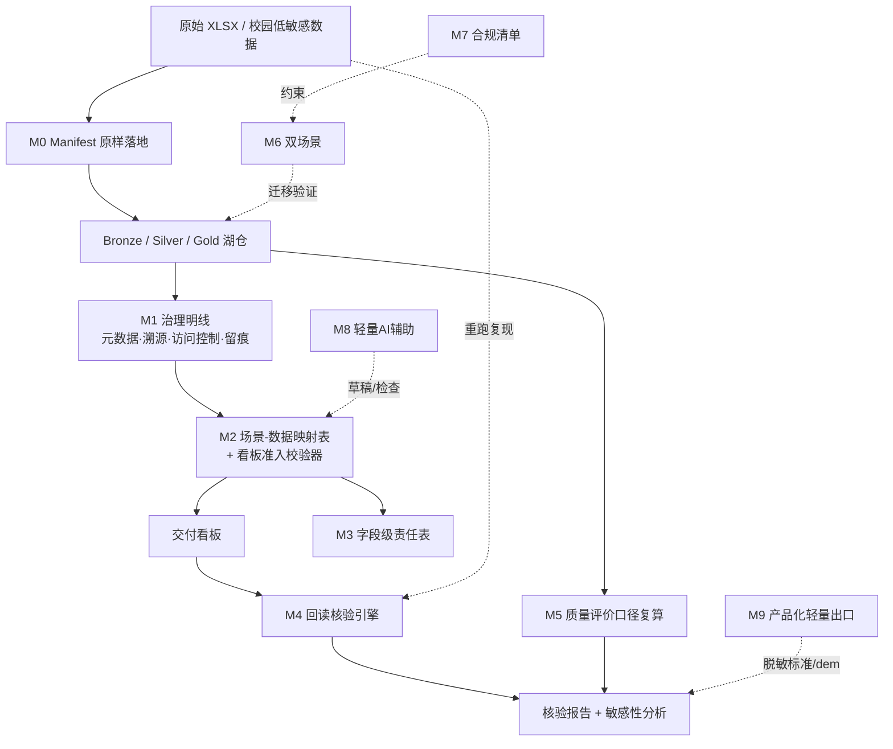
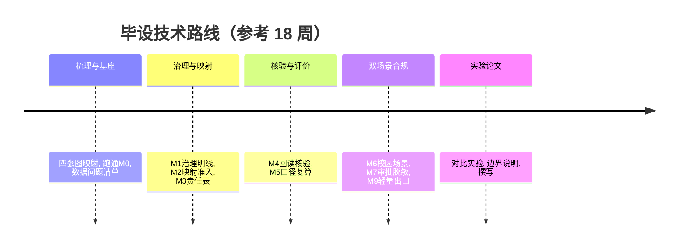

# 毕业设计开题报告

**课题名称**：把「四张图」跑成流水线：数智校园数据基座「一数一源一责」可核验交付原型的设计与实现
**副题**：「没有回读，就还是 PPT」——从场景—数据映射到回读核验
**理念依据**：《数智校园规划：数据基座和大模型该怎样排序》（数智转型洞察，2026-10-28）
**课题来源**：课程建设 / 教学线培育选题（数智校园规划的「课程版」与「代码版」）
**课题类型**：数据工程 + 软件原型（计算机 / 数据科学与大数据技术 / 软件工程）
**适用对象**：数据工程基础扎实、能独立完成流水线实现与实验验证的本科毕业生
**文档版本**：v2.0（正式题名版）　整理日期：2026-11-05

---

## 一、选题依据与意义

### 1.1 现实背景：规划的顺序问题

近一个月，部分高校陆续摊开「十五五」智慧校园图纸，共同特征是加强顶层设计、数智基座、数智大脑、场景重塑、数字素养与安全防线。一个反直觉的现象是：**越是把数智化想明白的学校，规划第一页写的越不是「大模型」**。

《数智校园规划：数据基座和大模型该怎样排序》给出的判断是：大模型是「应用层」，随时可换可加；数据基座是「地基」，一旦欠账，后面每一层应用都要替它还债。AI 落地分三层——智能底座吃「公域知识」、教育中台吃「校本知识」、业务智能体吃「业务数据」——但这三层其实是**同一口井的三级抽水**；井里没水（数据没治、口径不一、权责不清），无论最上层智能体堆得多高，**抽上来的都是泥沙**。

文章结语点题：**模型可以一年一换，基座要用十年**；规划里最贵的一句话从来不是「部署大模型」，而是「建成全域数据基座」。有厂商方案把「湖仓一体化 AI 数据中台 + 高校垂域大模型 + 智能体资源仓库 + 操作系统」做成四层底座，其立意被概括为「**智能体是树，数据中台是土**」「不做烟囱，做地基」。

### 1.2 课程语境：同构关系已经存在

本校数据基座相关课程已形成**四段能力链**：① 数据接入（Manifest、原样落地）② 湖仓分层（Bronze / Silver / Gold）③ 特征语料 ④ 交付看板。文章五环节 **采、存、治、用、评** 与之高度同构：采对应接入、存对应湖仓、用对应特征语料与看板。

两处尚未打通：**「治」分散在元数据登记、溯源、访问控制等检查点里，未成为明线**；**「评」仅有 `dq_report` 质量报告，缺少可论证的质量评价维度**。文章恰好指出「评价这件事，从来不是靠模型算出来的，是靠数据喂出来的」，并建议以「德、技、能、为」四维评价让成长可量化、可追溯、可干预。

同时，课程答辩要求「全链路叙事完整」「看板数字必须能从原始 XLSX 重跑复现」，长期停留在口头规矩层面，缺少可交付、可校验的**证据形态**。而文章对「场景写成演示」的批评给出了一个很土的判据：**办完事有没有回到源头系统回读核验、留下可追溯单据；没有回读，就还是 PPT**。

### 1.3 研究意义

- **教学意义**：把「规划话语 ↔ 课程能力链」的同构关系显性化。学生第一次面对 29602 行带缺失、带非法时间戳的原始传感器数据时，「井里没水，抽上来的都是泥沙」从口号变成体感。
- **方法意义**：把文章「落地四张图」从规划交付清单**降维成学生能产出的代码与证据**，形成「能跑通、能复现、能追责、能复算」的可核验交付层。
- **课程群意义**：本题产出的干净特征表、映射表与口径规范，是后续「赋能」（第 4 学期）与「跃升」（第 5–6 学期）课程可复用的交接接口。
- **申报意义**：从「怎么用 AI 教」升级为「AI 时代最先稀缺的是能搭可靠数据流水线的人」，与第一次课 PPT「AI 越强，能维护数据流水线的工程师越稀缺」形成呼应。

### 1.4 立题支撑（真实数据与材料）

- **数据**：29602 行带缺失与非法时间戳的高炉原始传感器 XLSX，可完整重跑复现；
- **产物**：`sensor_catalog`（一测点一来源一口径雏形）、`dq_report`、金层清洁率 93.6%、看板指标 `daily_si_trend` 与 `condition_class_counts`、`si_label`（仅作质量标签）；
- **理念材料**：《数智校园规划：数据基座和大模型该怎样排序》全文要点，「课程与数据基座文章同构分析」笔记，课程四段能力链大纲。

---

## 二、国内外研究现状

### 2.1 数智校园规划中的「基座优先」叙事

「十五五」智慧校园规划的一个核心争论是建设顺序。主流主张把「一个智能中枢平台」与「一个全域数据基座」并列摆在核心位置，而非把大模型画在正中央；规划按 **筑基—赋能—跃升** 三级台阶推进：筑基期重「通」（业务系统接入、主数据统一、一数一源），赋能期重「用」（迎新、咨询、报账、助学金评定等高频刚需），跃升期重「智」（数智基座、本地算力、垂域模型、智能体矩阵）。**没有筑基，赋能就是无源之水；没有赋能，跃升就是空中楼阁**。

### 2.2 湖仓分层与数据全生命周期治理

Bronze / Silver / Gold 分层与「原样落地 + 逐层清洗」是数据湖仓通行范式。规划话语强调「五层架构贯通数据全生命周期」，坚持「一数一源一责、一源多用」，让数据在**采、存、治、用、评**里流转出价值。相关研究多关注企业级平台的分层模型与集成效率，对教学场景下的可复现性关注不足。

### 2.3 一数一源一责：责任机制而非技术机制

文章强调「基座不是技术活，是责任活」：每条关键数据要落到「谁产生、谁更新、谁签字」，并明确分类分级与最小必要权限。忽略这套机制，中台会变成访问量很低的「荣誉墙」。现有治理工具多面向企业级落地，缺少轻量、可进课堂、能与学生分工结合的形态。

### 2.4 智能体运行规矩与回读核验

有方案为智能体运行立了**五条硬规矩**：凭据信息不进模型和日志；关键业务提交前必须人工确认；业务办结后自动回读核验、以校方系统真实单据编号为准；所有操作全程留痕可审计；复杂不确定场景自动暂停、人工介入。这五条回答的是「当 AI 开始替人办事，谁签字、谁负责」。文章进一步给出落地判据：判断一个 AI 场景是否真落地，看它办完事后**有没有回到源头系统回读核验、留下可追溯单据**。数据测试中的断言与重跑、报表回读核验是常见手段，但将其工具化并嵌入课程交付流程的做法仍不多见。

### 2.5 数据质量评价与数据产品化

质量报告常给出清洁率等汇总数字，但口径由谁定、阈值怎么选、改动后如何变化，往往缺少可论证机制。文章在规划层面还提出**数据产品化路线图**：从资源目录到知识资产，再到可对标、可交付、可上架的数据集 / 语料，让基座不只是「内部的水管」，还是「对外的货架」；并列举了高校数据集上架、多语种高教跨学科语料数据集等案例。

### 2.6 三个最容易踩的坑与本课题切入点

文章总结规划三坑：① 把规划写成采购清单（买模型 ≠ 建基座）② 把基座写成纯技术活（忽略责任机制）③ 把场景写成演示（无回读即 PPT）。

**本课题切入点**：现有工作或偏企业级平台、或偏单一工具、或停留在规划文本，缺少一个**面向课程、把规划「四张图」降维为可运行产物、以回读核验为落地判据、并明确划清教学边界的轻量原型**。本课题不重做流水线，而是在课程已有四段能力链之上加一层可核验交付层，打通两个新接口——内部（治理显性化 + 补「评」）、外部（校园低敏感数据双向咬合）。

---

## 三、研究目标与内容

### 3.1 研究目标

1. 将文章「落地四张图」逐张翻译为学生可交付、可校验的产物：总体架构图、场景—数据映射表、一数一源一责责任清单、数据产品化轻量出口；
2. 以「**没有回读，就还是 PPT**」为判据，构建**回读核验引擎**，把「看板数字能从原始 XLSX 重跑复现」从口头规矩变成自动化工具，并支持交叉组抽查；
3. 把「治」显性化为明线，把质量评价维度补进「评」，让 `93.6%` 这类数字**口径可配置、可复算、可论证**；
4. 通过**双场景**（高炉传感器 + 校园低敏感数据）验证方法通用性，形成合规流程产物，实现教学与学校数智化的双向咬合。

### 3.2 核心设计：四张图的降维（本文关键）

| 文章「落地四张图」 | 规划话语 | 本课题的学生产物 | 验收证据 |
| --- | --- | --- | --- |
| ① 总体架构图 | 智能中枢与全域数据基座并列，标清谁产出 / 谁汇聚 / 谁消费；别把大模型画在正中央 | M0 四段能力链 + 总体架构图（代码与配置驱动） | 架构图 + 数据流配置 |
| ② 场景—数据映射表 | 每个拟上线场景写明依赖哪些数据、来自哪个系统、口径由谁定义；**列不出的场景先别立项** | **M2 映射表 + 看板准入校验器**（列不出的图表不许上看板） | 映射表 + 准入拦截记录 |
| ③ 一数一源一责责任清单 | 关键数据逐条落到「谁产生、谁更新、谁签字」，明确分类分级与最小必要权限 | **M3 字段级责任表**（`sensor_catalog` 加责任人列） | 责任表 + 覆盖率统计 |
| ④ 数据产品化路线图 | 从资源目录到知识资产，再到可交付数据集 / 语料 | **M9 教学语境轻量出口**（脱敏元数据标准、教学数据集样例、场景 demo） | 脱敏标准 + demo 说明 |

> **边界**：第 ④ 张只做教学语境的轻量出口，不碰交易所、资产经营、校级预算排序。

### 3.3 五环节与课程能力链的映射

| 文章环节 | 课程能力链 | 现状 | 本题动作 |
| --- | --- | --- | --- |
| 采 | ① 数据接入（Manifest、原样落地） | 已对齐 | 沿用 |
| 存 | ② 湖仓（Bronze/Silver/Gold） | 已对齐 | 沿用 |
| 治 | 分散在元数据登记、溯源、访问控制 | 隐含 | **显性化为明线** |
| 用 | ③ 特征语料 + ④ 交付看板 | 已对齐 | 加映射与准入 |
| 评 | 仅 `dq_report` 质量报告 | 偏弱 | **补口径可论证维度** |

### 3.4 研究内容（严格区分「沿用 / 显性化 / 新增」）

| 模块 | 内容 | 性质 | 对应文章 |
| --- | --- | --- | --- |
| **M0** 采 / 存基座 | Manifest 原样落地 + Bronze/Silver/Gold 分层；29602 行高炉原始 XLSX | 沿用课程 | 采、存 / 五层架构 |
| **M1** 治理明线 | 元数据登记、溯源、访问控制抽成独立模块，显式产出治理清单与留痕记录 | 显性化 | 治 / 责任活 / 全程留痕 |
| **M2** 场景—数据映射表 + 看板准入校验器 ⭐ | 每个看板指标登记「依赖哪段产物、来自哪个 parquet、口径谁定」；**列不出的图表不许上看板** | 新增 | 四张图② |
| **M3** 一数一源一责 | `sensor_catalog` 加一列「责任人」，形成字段级责任表 | 新增 | 四张图③ |
| **M4** 回读核验引擎 ⭐ | 看板数字必须能从原始 XLSX 重跑复现；输出核验报告；支持**别组抽查别组数字现场重算** | 新增 | 五条硬规矩 / 坑三 |
| **M5** 质量评价口径复算 | 清洁率口径可配置、可论证、阈值敏感性分析；`dq_report` 升级为带口径说明与敏感性曲线的报告 | 新增 | 评 / 评价靠数据喂 |
| **M6** 双场景迁移 | 高炉 + 校园低敏感场景（教室占用、图书馆座位、食堂人流、实验室巡检记录）走同一链路 | 新增 | 赋能期高频刚需场景 |
| **M7** 合规产物 | 数据申请审批、脱敏、最小必要授权检查清单；输出脱敏元数据标准 | 新增 | 分类分级 / 最小必要权限 |
| **M8** 轻量 AI 辅助（可选） | LLM 辅助生成字段口径说明草稿、异常数据归因、映射表一致性检查 | 可选 | 智能底座（仅辅助） |
| **M9** 数据产品化轻量出口（可选） | 脱敏元数据标准、可对标的教学数据集样例、给信息中心的场景 demo | 可选 | 四张图④ |

> **AI 边界**：本课定位「筑基」，**不做模型训练**（`si_label` 只是质量标签），不部署垂域模型、不做智能体编排。AI 仅作辅助，口径定义与结论由人确定，LLM 不生成结论、不替代核验。这呼应文章判断：三层模型是同一口井的三级抽水，本课题只负责**把井打深**。

---

## 四、研究方法与技术路线

### 4.1 总体架构

> 架构图呼应文章「总体架构图」要求：**并列画出基座与交付，不把模型放在正中央**。

### 4.2 关键方法

| 模块 | 方法要点 | 输入 → 输出 |
| --- | --- | --- |
| M2 映射与准入 | YAML 登记「指标—产物—parquet—口径—责任人」；上线前做一致性与完整性校验，缺项即拦截 | 指标定义 → 准入结果 |
| M3 责任表 | `sensor_catalog` 扩展责任人字段，按字段粒度生成分工表并校验覆盖率 | 测点目录 → 字段级责任表 |
| M4 回读核验 | pytest 断言固化「看板数字 = 从原始 XLSX 重跑结果」，输出核验报告；提供交叉组抽查入口 | 原始 XLSX + 看板 → 核验报告 |
| M5 口径复算 | 清洁率口径参数化（缺失阈值、非法时间戳判据等），扫描阈值生成敏感性曲线 | 口径配置 → 清洁率与曲线 |
| M6 双场景 | 配置驱动场景切换，复用同一流水线与核验规则 | 场景配置 → 迁移验证结果 |
| M7 合规 | 审批 / 脱敏 / 最小必要授权检查清单，输出脱敏元数据标准 | 申请流程 → 合规产物 |
| M9 轻量出口 | 从映射表与责任表派生脱敏元数据标准、教学数据集样例说明与场景 demo | 治理产物 → 教学数据集说明 |

### 4.3 技术栈

Python（pandas / pyarrow）｜Parquet + DuckDB 或 SQLite｜PyYAML（映射表与口径配置）｜pytest（回读核验断言）｜Streamlit 或 Gradio（参数界面与看板）｜可选 LLM API（仅做辅助草稿）。

### 4.4 技术路线图

---

## 五、创新点

1. **规划话语 → 代码产物的降维**：把文章「落地四张图」逐张翻译为学生可交付、可校验的工程产物，回应「别让学生写规划」的教学边界，也让「全链路叙事完整」有证据形态。
2. **以「没有回读，就还是 PPT」为落地判据**：把文章对场景演示化的批评，转化为 M4 回读核验引擎与交叉组抽查机制，形成可自动执行的验收标准。
3. **治理显性化 + 责任可追溯**：把「治」从隐含检查点变成一等公民模块，`sensor_catalog` 加责任人列实现字段级「一数一源一责」，让团队角色从口号变成产物。
4. **「评」的口径可论证**：让学生自己论证 `93.6%` 怎么定的，呼应「评价靠数据喂，不靠模型算」，补上五环节中课程最弱的一环。
5. **双场景 + 合规即教材 + 轻量产品化出口**：校园低敏感数据让教学与学校数智化咬合，审批 / 脱敏流程成为治理活教材，M9 提供教学数据集样例与场景 demo 反向输出。

---

## 六、进度安排

| 阶段 | 周次（参考） | 主要任务 | 里程碑 |
| --- | --- | --- | --- |
| 一、梳理与基座 | 1–3 | 精读文章并固化四张图映射；跑通 M0；整理高炉数据问题清单 | 映射表 v0 + 流水线 v0 |
| 二、治理与映射 | 4–7 | M1 治理明线；M2 映射表 + 准入校验器；M3 责任表 | 四张图②③ 产出 |
| 三、核验与评价 | 8–11 | M4 回读核验引擎（含交叉组抽查）；M5 口径复算与敏感性分析 | 核验报告 + 曲线 |
| 四、双场景与合规 | 12–14 | M6 校园场景；M7 审批 / 脱敏 / 最小必要清单；M9 轻量出口；M8 可选 | 完整原型 + 四张图① |
| 五、实验与论文 | 15–18 | 对比实验、边界说明、撰写 | 实验报告 + 论文 |

**难度分档**：基础版（M0+M1+M2+M4+单场景+对比实验，★★）｜进阶版（基础 +M3+M5，★★★，推荐主力）｜拔高版（进阶 +M6+M7+M9，★★★★，需学校审批配合）。

---

## 七、预期成果（按四张图对齐）

| 文章四张图 | 预期交付物 |
| --- | --- |
| ① 总体架构图 | 可运行流水线 + 总体架构图 + 数据流配置 |
| ② 场景—数据映射表 | 映射表 + 看板准入校验器 + 拦截记录 |
| ③ 一数一源一责责任清单 | 字段级责任表 + 覆盖率统计 |
| ④ 数据产品化路线图 | 脱敏元数据标准 + 教学数据集样例说明 + 场景 demo |

另交付：回读核验引擎与核验报告（支持交叉组抽查）、质量评价口径配置与复算 / 敏感性分析模块、对比实验记录与边界说明、毕业设计论文 1 篇。

---

## 八、研究的局限与风险（红线）

- ❌ **不写规划**：题目里的「四张图」是文章的交付清单，学生做的是把它**实现成可运行产物**，不是撰写校园信息化规划。校级预算排序、数据交易所、跨部门确权、资产经营**不进课题内容**（最多第一次课 10 分钟当背景）。
- ❌ **不碰大模型主线**：本课定位「筑基」，不做模型训练、不部署垂域模型、不做智能体编排；`si_label` 只是质量标签。边界的正当性来自课程群叙事——**不是不敢做 AI，是这一级只负责把井打深**。
- ❌ **校园真实数据必须先过学校审批再进机房**：严格执行审批、脱敏、最小必要授权，不踩数据合规红线；M9 仅输出脱敏后的教学样例。
- ❌ **不声称校级数据基座建设成果**：产出是教学原型与课程交付物，非校级基座验收。
- ❌ **AI 不生成结论**：LLM 仅做口径说明草稿、异常归因与一致性检查；关键结论与口径由人确定，核验结果以回读为准。
- 高炉数据为教学案例，结论不外推为工业现场效果；机理与口径均为简化建模，需声明误差来源与适用范围。

---

## 九、参考文献

> 以下含**已核实的理念依据**与**建议检索方向**；其余条目请按学校格式补实际文献（严禁编造引文）。

**理念依据（已核实著录信息）**
1. 数智转型洞察.《数智校园规划：数据基座和大模型该怎样排序》. 微信公众号文章，2026-10-28，湖南. 资料库副本：WorkBuddy 资料库 `https://www.workbuddy.cn/space/d/xP71eSvlztEvJOREY4BOPM`；IMA 知识库「中南大学教学库」`https://ima.qq.com/wiki/buddy-knowledge/aanlwcmgybmou?autoOpenMedia=1&webFrom=10001041`。

**建议检索方向**
2. 数智校园「十五五」规划与基座优先：检索「智慧校园 十五五 全域数据基座」「智能中枢 数据基座 并列」。
3. 数据湖仓分层与原样落地：检索「medallion architecture bronze silver gold」「data lakehouse ingestion manifest」。
4. 数据治理与元数据血缘：检索「data lineage metadata management」「一数一源一责 数据治理」。
5. 数据质量评价与口径：检索「data quality metrics threshold sensitivity」「数据质量 清洁率 口径」。
6. 可复现与数据测试：检索「data testing assertions reproducibility」「report reconciliation audit」。
7. 智能体运行规矩与回读核验：检索「AI agent human-in-the-loop audit trail」「智能体 回读核验 留痕」。
8. 校园数据合规与脱敏：检索「data minimization anonymization education data」「教育数据 脱敏 审批」。
9. 数据产品化与高校数据集上架：检索「research data productization dataset publishing」「高校 数据集 上架 语料」。
10. AI 时代数据工程能力：检索「data engineering for AI agents」「数据中台 智能体 基座」。
11. 课程材料：本校数据基座课程大纲、课程与数据基座文章同构分析笔记。

（建议数据库：中国知网 CNKI、IEEE Xplore、ACM DL、ScienceDirect；开题报告中需列出不少于 15 篇近五年中英文文献。）

---

## 十、附录：对比实验设计（核心）

### 10.1 实验组（统一输入条件，保证可比）

| 组 | 配置 | 目的 |
| --- | --- | --- |
| Baseline | 课程现有四段流水线 + `dq_report` | 参照 |
| E1 | + M2 映射表与看板准入 | 验证「列不出口径的图表被拦截」 |
| E2 | + M4 回读核验 | 验证「数字可复现」与交叉组抽查 |
| E3 | + M5 口径复算 | 验证「清洁率可论证」 |
| E4 | + M6 双场景 | 验证方法通用性与迁移成本 |

**交叉组抽查**：别组用本组核验引擎现场重算别组看板数字，作为独立验证——对应文章「办结后自动回读核验、全程留痕可审计」。

### 10.2 量化指标

| 指标 | 口径 |
| --- | --- |
| 看板指标映射覆盖率 | 已登记映射的看板指标 ÷ 全部指标（目标 100%） |
| 准入拦截数 | 因缺映射 / 口径被拒绝上线的图表数 |
| 回读一致率 | 能从原始 XLSX 重跑复现的指标比例（数值误差 ≤ ε） |
| 缺陷检出率 | 非法时间戳 / 缺失 / 口径冲突被拦截的比例 |
| 字段级责任覆盖率 | 已落责任人的字段 ÷ 全部字段 |
| 清洁率口径敏感性 | 阈值 ±Δ 下 `93.6%` 的变化区间与拐点 |
| 场景迁移成本 | 新增一个场景需修改的配置项数 / 人时 |
| 重跑耗时 | 单次全链路重跑耗时（秒） |

> 指标把「更可信、更可追责、更可论证、更易迁移」四条价值量化，作为答辩证据形态；判据落在**回读**，而非演示效果。

---

## 十一、课程群叙事定位（三级台阶）

| 台阶 | 文章（规划节奏） | 课程群（学期） | 定位 |
| --- | --- | --- | --- |
| 筑基 | 重「通」：业务系统接入、主数据统一、一数一源 | 第 3 学期 本课 | 把水抽干净，止于数据准备 |
| 赋能 | 重「用」：迎新、咨询、报账、助学金评定等高频刚需场景 | 第 4 学期 数据分析挖掘开发实践 | 在干净特征表上做分析，先尝到甜头 |
| 跃升 | 重「智」：数智基座、本地算力、垂域模型、智能体矩阵 | 第 5–6 学期 多模态 / 综合应用实践 | 吃前面攒下的数据，长 AI 应用与智能体 |

本题产出的干净特征表与映射 / 口径规范，是后两级可复用的**交接接口**；申报材料论证角度为「**模型可以一年一换，基座要用十年**」——本课为 AI 课程群打地基，与「智能体是树，数据中台是土」「AI 越强，能维护数据流水线的工程师越稀缺」形成三级呼应。

---

*本开题报告为 v2.0 正式题名版，基于《数智校园规划：数据基座和大模型该怎样排序》与课题内容设计扩写；文章要点取自资料库命中原文。具体数据集范围、口径阈值与校园场景需按学校审批结果细化。*
