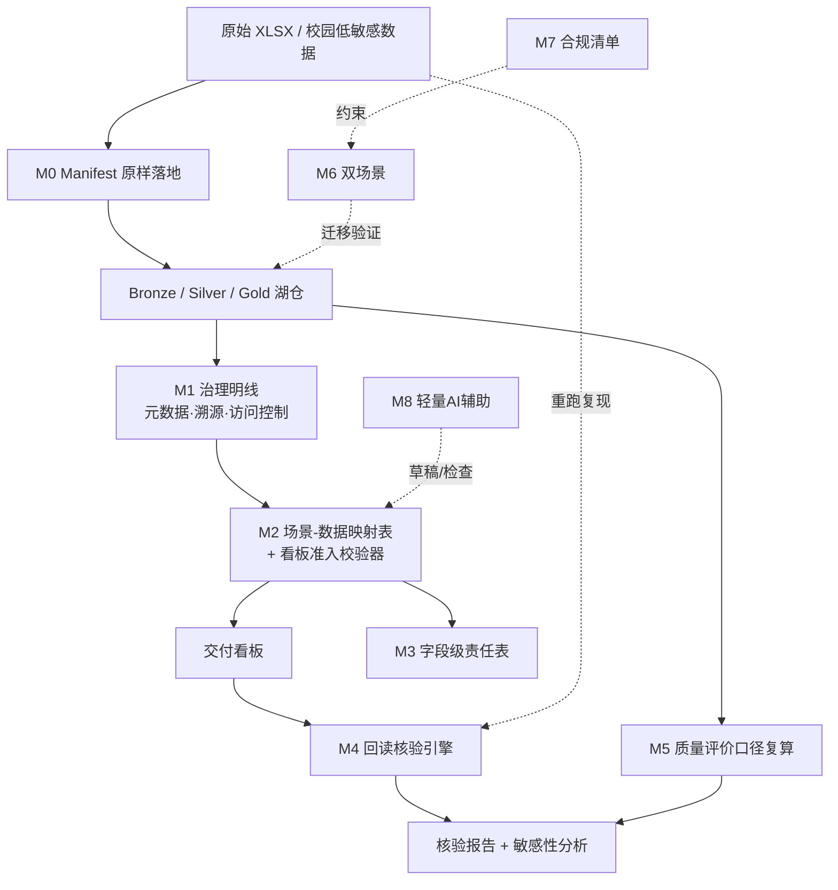

# 毕设题目设计：「一数一源一责」可核验数据交付原型

> 基于「数据基座文章理念 ↔ 课程四段能力链」同构关系分析
> 适用：计算机 / 数据科学与大数据技术 / 软件工程本科毕业设计
> 版本 v1.0　整理日期：2026-11-05

---

## 一、设计判断：题目该落在哪里

文章五环节 **采—存—治—用—评** 与课程四段能力链 **① 数据接入（Manifest、原样落地）② 湖仓（Bronze/Silver/Gold）③ 特征语料 ④ 交付看板** 已高度同构：

| 文章 | 课程 | 状态 |
| --- | --- | --- |
| 采 | ① 数据接入 | 已对齐 |
| 存 | ② 湖仓分层 | 已对齐 |
| 治 | 分散在元数据登记、溯源、访问控制 | **需显性化**（治理做明线，不藏在检查点里） |
| 用 | ③ 特征语料 + ④ 交付看板 | 已对齐 |
| 评 | 仅 `dq_report` 质量报告 | **需补维度**（清洁率口径可论证） |

**结论**：毕设不重做流水线（学生课上已在做），而是把文章「四张图」降维为**可验证的课程交付物**，并打通两个新接口：

- **接口 A（内部）**：治理显性化 + 「评」环节补强 → 让「全链路叙事完整」的答辩检查点有**证据形态**；
- **接口 B（外部）**：校园低敏感数据双向咬合（校园进课堂 / 成果反向输出信息中心）。

一句话定位：**不是把井再打一遍，是给这口井装一套「水质可验、责任到人、口径可辩」的计量与追溯装置。**

---

## 二、题目

### 主推题目

**「一数一源一责」可核验数据交付原型的设计与实现**
——面向数据基座课程：场景—数据映射、回读核验与质量评价口径复算

### 备选题目（按侧重）

| 编号 | 题目 | 侧重 | 备注 |
| --- | --- | --- | --- |
| A | 数据基座「评」环节的补强：金层清洁率口径可论证与 `dq_report` 复算工具 | 窄而深，直击「评」缺口 | 工作量小、最易出彩 |
| B | 双场景数据流水线与合规治理原型：高炉传感器 + 校园低敏感数据 | 接口 B（校园即案例） | 需先过学校数据审批 |
| C | 看板准入与交叉组回读核验工具链：答辩证据形态的自动化 | 工程严谨性 | 适合偏软件工程的学生 |

> 三备选均可单独成题，也可作为主推题目的子模块。

---

## 三、研究目标

1. 在课程已有的四段流水线之上，构建一套**可核验交付层**：场景—数据映射、字段级责任登记、回读核验、质量评价口径复算。
2. 把「治理」从分散在各段检查点里的隐含动作，**显性化为一等公民模块**（明线），产出可交付、可校验的治理产物。
3. 把文章的质量评价维度补进「评」：让 `93.6%` 这类数字**口径可配置、可复算、可论证**，而非一个写死的结论。
4. 通过**双场景**（高炉传感器 + 校园低敏感）验证方法的通用性，并形成合规流程产物，实现教学与学校数智化的双向咬合。

---

## 四、研究内容与模块（严格区分「沿用 / 显性化 / 新增」）

| 模块 | 内容 | 性质 | 对应文章要素 |
| --- | --- | --- | --- |
| **M0** 采 / 存基座 | Manifest 原样落地 + Bronze/Silver/Gold 分层；29602 行带缺失、非法时间戳的高炉原始 XLSX | **沿用课程** | 采、存 |
| **M1** 治理明线 | 把元数据登记、溯源、访问控制抽成独立模块并显式产出治理清单 | **显性化**（不新增功能） | 治 |
| **M2** 场景—数据映射表 + 看板准入校验器 ⭐ | 每个看板指标（`daily_si_trend`、`condition_class_counts`）登记「依赖哪段产物、来自哪个 parquet、口径谁定」；**列不出的图表不许上看板** | **新增（核心证据）** | 场景—数据映射表 |
| **M3** 一数一源一责 | `sensor_catalog` 在「一测点一来源一口径」基础上**加一列「责任人」**，形成字段级责任表 | **新增（轻量）** | 一数一源一责 / 目标4 团队角色 |
| **M4** 回读核验引擎 ⭐ | 看板数字必须能从原始 XLSX 重跑复现；输出核验报告；支持**别组抽查别组数字现场重算** | **新增（核心）** | 回读核验 |
| **M5** 质量评价口径复算 | 清洁率等指标口径可配置、可论证、做阈值敏感性分析；`dq_report` 升级为带口径说明与敏感性曲线的报告 | **新增（补「评」）** | 评 / 金层清洁率 93.6% |
| **M6** 双场景迁移 | 高炉 + 校园低敏感场景（教室占用、图书馆座位、食堂人流、实验室巡检记录）走同一条链路 | **新增（接口 B）** | 校园数据进课堂 |
| **M7** 合规产物 | 数据申请审批、脱敏、最小必要授权检查清单；输出一份脱敏元数据标准 | **新增（接口 B）** | 合规即教材 / 反向输出 |
| **M8** 轻量 AI 辅助（可选） | LLM 辅助生成字段口径说明草稿、异常数据归因、映射表一致性检查 | **可选** | AI 触点 |

> **AI 边界**：本课定位「筑基」，**不做模型训练**（`si_label` 只是质量标签）。AI 仅作辅助，口径定义与结论仍由人确定，LLM 不生成结论、不替代核验。

---

## 五、技术路线

### 5.1 总体架构

### 5.2 建议技术栈

Python（pandas / pyarrow）｜Parquet + DuckDB 或 SQLite｜PyYAML（映射表与口径配置）｜pytest（回读核验断言）｜Streamlit 或 Gradio（参数界面与看板）｜可选 LLM API（仅做辅助草稿）。

### 5.3 进度（参考 18 周）

| 阶段 | 周次 | 任务 |
| --- | --- | --- |
| 一、梳理与基座 | 1–3 | 梳理五环节↔四段映射；跑通 M0；整理高炉原始数据问题清单 |
| 二、治理与映射 | 4–7 | M1 治理明线；M2 映射表 + 准入校验器；M3 责任表 |
| 三、核验与评价 | 8–11 | M4 回读核验引擎；M5 口径复算与敏感性分析 |
| 四、双场景与合规 | 12–14 | M6 校园场景；M7 审批/脱敏/最小必要清单；M8 可选 |
| 五、实验与论文 | 15–18 | 对比实验、边界说明、撰写 |

---

## 六、对比实验与验收指标（本课题的「证据形态」）

### 6.1 实验组

| 组 | 配置 | 目的 |
| --- | --- | --- |
| Baseline | 课程现有四段流水线 + `dq_report` | 参照 |
| E1 | + M2 映射表与看板准入 | 验证「列不出口径的图表被拦截」 |
| E2 | + M4 回读核验 | 验证「数字可复现」与交叉组抽查 |
| E3 | + M5 口径复算 | 验证「清洁率可论证」 |
| E4 | + M6 双场景 | 验证方法通用性与迁移成本 |

**交叉组抽查**：别组用本组核验引擎现场重算别组看板数字，作为独立验证。

### 6.2 量化指标

| 指标 | 口径 |
| --- | --- |
| 看板指标映射覆盖率 | 已登记映射的看板指标 ÷ 全部指标（目标 100%） |
| 准入拦截数 | 因缺映射/口径被拒绝上线的图表数 |
| 回读一致率 | 能从原始 XLSX 重跑复现的指标比例（数值误差 ≤ ε） |
| 缺陷检出率 | 非法时间戳 / 缺失 / 口径冲突被拦截的比例 |
| 字段级责任覆盖率 | 已落责任人的字段 ÷ 全部字段 |
| 清洁率口径敏感性 | 阈值 ±Δ 下 `93.6%` 的变化区间与拐点 |
| 场景迁移成本 | 新增一个场景需修改的配置项数 / 人时 |
| 重跑耗时 | 单次全链路重跑耗时（秒） |

---

## 七、创新点

1. **治理显性化**：把「治」从藏在检查点里的隐含动作，变成可交付、可校验的一等公民模块。
2. **看板准入机制**：场景—数据映射表作为图表上线的硬约束，把「全链路叙事完整」从答辩要求变成自动化证据。
3. **回读核验 + 交叉组抽查**：把「数字必须能重跑复现」从口头规矩变成工具链，并引入组间独立验证。
4. **「评」的口径可论证**：让学生自己论证 `93.6%` 怎么定的，补上文章五环节里课程最弱的一环。
5. **双场景 + 合规即教材**：校园低敏感数据让教学与学校数智化真正咬合，审批/脱敏流程本身成为治理活教材。

---

## 八、红线与边界（必须写进论文）

- ❌ **不做模型训练**：本课定位「筑基」，`si_label` 只是质量标签；边界的正当性来自课程群叙事——**不是不敢做 AI，是这一级只负责把井打深**。
- ❌ **不写规划**：校级预算排序、数据交易所、跨部门确权**不进课题内容**（最多作为背景了解）；学生写的是流水线与工具，规划是课程组的事。
- ❌ **校园真实数据必须先过学校审批再进机房**：严格执行审批、脱敏、最小必要授权，不踩数据合规红线。
- ❌ **不声称校级数据基座建设成果**：产出是教学原型与课程交付物。
- ❌ **AI 不生成结论**：LLM 仅做口径说明草稿、异常归因与一致性检查，结论与口径由人确定。

---

## 九、可执行度与难度

| 档位 | 组合 | 难度 | 说明 |
| --- | --- | --- | --- |
| 基础版（稳过） | M0 + M1 + M2 + M4 + 单场景 + 对比实验 | ★★ | 数据现成、技术成熟 |
| 进阶版（推荐） | 基础 + M3 + M5（口径可论证） | ★★★ | 最贴「一数一源一责」与「评」 |
| 拔高版（优秀） | 进阶 + M6 双场景 + M7 合规 + M8 轻量 AI | ★★★★ | 需学校审批配合，工期需留余量 |

**总体判断**：可执行度**高**（29602 行高炉数据现成、四段流水线已有、技术栈成熟、无需模型训练）；难度**中等**——难点不在算法，而在**工程严谨性与口径定义**，正好匹配「数理/工程基础扎实、能独立做实验」的学生。

---

## 十、课程群与申报叙事（本题目的额外价值）

- **三级台阶**：第 3 学期（本课）= **筑基**（把水抽干净，止于数据准备）；第 4 学期数据分析挖掘开发实践 = **赋能**；第 5–6 学期多模态/综合应用实践 = **跃升**。本题产出的干净特征表与映射/口径规范，正是后两级可复用的**交接接口**，可直接写进培养方案课程链描述。
- **申报材料论证角度**：从「怎么用 AI 教」升级为「**智能体是树，数据中台是土；模型可以一年一换，基座要用十年**」——AI 时代最先稀缺的是能搭可靠数据流水线的人，本课为 AI 课程群打地基。与第一次课 PPT「AI 越强，能维护数据流水线的工程师越稀缺」形成呼应。
- **第一次课的体感锚点**：用「井里没水，抽上来的都是泥沙」引入，学生面对 29602 行带缺失、非法时间戳的原始数据时，口号变成体感。

---

## 十一、交付物清单

- [ ] 可运行流水线（采/存/治/用/评，含双场景）
- [ ] 场景—数据映射表 + 看板准入校验器
- [ ] 字段级「一数一源一责」责任表
- [ ] 回读核验引擎 + 核验报告（支持交叉组抽查）
- [ ] 质量评价口径配置 + 复算与敏感性分析模块
- [ ] 合规检查清单 + 脱敏元数据标准（可反向输出信息中心）
- [ ] 对比实验记录与边界说明
- [ ] 论文 1 篇

---

*本设计为题目与内容骨架，可直接扩写为开题报告；具体数据集范围、口径阈值与校园场景需按学校审批结果细化。*
