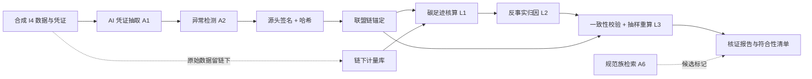

# 毕设题目设计（F 线）：区块链碳足迹溯源与 AI 减碳归因

> **性质**：本科毕业设计题目设计稿，含题目、内容、目标、方案、结果五部分。
> **依据课题**：《冶金炉窑 MES×EMS 源网荷储一体化总体方案》及其 I4 统一计量与碳账底座；承接 A 线「虚拟电厂—柔性冶炼负荷的绿电调度仿真」。
> **编制日期**：2026-11-05　**归档定位**：`course-lab` 教学线 F 线（题目设计阶段，题名待指导组锁定）
> **合规口径**：对外统一「降低碳成本暴露与履约缺口」，不做税务安排式表述；**不编造标准编号、政策条文、文献、排放因子与实验数据**。

---

## 零、一页速览：直接回答「题目、内容、目标、方案、结果」

| 用户要的 | 一句话答案 | 详见 |
|---|---|---|
| **题目** | 《把每一吨碳算回证据：面向冶金炉窑绿电消纳的区块链碳足迹溯源与 AI 减碳归因原型》，副题「没有证据链，减碳量就只是估算」 | 第二章 |
| **内容** | 不重做调度，而是给上一课题的 I4 计量底座加一层「可核证碳证据链」：凭证结构化 → 链上锚定 → 碳足迹核算 → 反事实归因 → 核证报告，M0–M8 共九个模块 | 第四章 |
| **目标** | 让每一吨 CO2e 都能算回原始凭证，让「系统减了多少碳」变成可复算、可归因、可质疑的实验结果；同时严格符合国内外规范族的口径要求 | 第三章 |
| **方案** | 联盟链只存哈希/时间戳/签名/口径版本（原始数据留链下）；AI 只做凭证抽取、异常检测、解释生成、基线归因、对账与规范辅助检查，**不出具合规结论**；减碳量用反事实基线而非前后对比 | 第五、六、七章 |
| **结果** | 可运行原型 + 合成数据集与 ground truth + 四组对照实验 + 核证报告 + 规范核对清单；6 条验收阻断项（含「链上存了原始明细」「只做前后对比」「编造标准编号」一票否决） | 第八章 |

---

## 一、来源、定位与降维

### 1.1 承接关系

上一课题解决了「让负荷曲线去追绿电曲线」，并留下 I4 统一计量底座：**时段—产线—设备—电量—排放因子 + 绿电属性溯源 + 统一时标与设备编码**。但那份方案是工程实施级，只回答「怎么调度」，没有回答一个更硬的问题：

> **绿电多用了一点、储能少动了一点，到底减了多少碳？这个数字凭什么让别人信？**

本课题就做这一层。它**不重做调度、不重做 MES×EMS 接口、不接真实系统**，而是把上一课题的 I4 数据契约与 A 线的柔性调度仿真结果**离线复刻为合成数据集**，在上面构建可核证的碳证据链。

### 1.2 从工程课题降维为本科毕设

| 工程课题版 | 本毕设版 | 原因 |
|---|---|---|
| 接真实 MES/EMS、PLC/DCS、并网点 | 合成 I4 数据集 + 本地仿真，不接任何真实系统 | 不接真实工业系统 |
| 真实绿证归集、配额履约、CBAM 申报 | 只做口径演示与证据链，不申报、不交易 | 不做真实碳资产业务 |
| 多方真实主体上链 | 本地多节点模拟（生产 / 能源 / 绿证 / 核证 / 下游客户） | 不对外发布、不接公链 |
| 12 个月真实基线 | 合成基线 + 人工埋点 ground truth | 数据可获取、结论可证伪 |
| 第三方核证 | 「第三方可复算」证据包与抽样重算 | 不声称已获核证 |

**这一降维反而让题目更硬**：合成数据自带 ground truth，可以定量算「减碳归因偏差」「重复声明检出率」，而真实项目往往连分母都没有。

### 1.3 与前五条毕设线的关系

| 线 | 复用点 |
|---|---|
| A 虚拟电厂柔性冶炼绿电调度 | 柔性负荷与绿电出力仿真曲线作为**输入**，不重做调度器 |
| B 回转窑—矿热炉联动（AI 增强） | 轻量 RAG → 规范条款检索与依据展示（A6） |
| C 把「四张图」跑成流水线 | 「一数一源一责」→ **一度电一凭证一归属**；「回读核验」→ **抽样重算与链上链下一致性校验** |
| D 线 多智能体冶金工程设计协同 | 评测规范、`golden.json`、可回放日志、三分责任表、验收阻断项 |
| E 线 证券决策场景可核验协同 | 结构化证据与解释模板、红线话术、合规叙事口径 |
| 上一课题 MES×EMS | I4 计量口径、接口治理思想、KPI 数值纪律、合规表述 |

**定位一句话**：A–E 五条线都在让系统「更聪明 / 更柔性」，**F 线负责让结果「可证明」**。它也是《数智校园规划》那句「没有回读，就还是 PPT」在碳账维度的对应物——**没有证据链，减碳量就只是估算**。

---

## 二、题目与命名口径

### 2.1 主推题名

> **《把每一吨碳算回证据：面向冶金炉窑绿电消纳的区块链碳足迹溯源与 AI 减碳归因原型》**
> **副题**：「没有证据链，减碳量就只是估算」——从分时电量的链上锚定到反事实基线归因

### 2.2 备选题名

| 编号 | 题名 | 侧重 |
|---|---|---|
| A | 一度电一凭证一归属：冶金炉窑碳足迹可信存证与减碳归因原型 | 承接 C 线「一数一源一责」，叙事最顺 |
| B | 从分时电表到可核证碳账：区块链存证与 AI 辅助核算的设计与实现 | 偏工程交付，适合编码能力强的学生 |
| C | 绿电消纳的减碳量到底怎么算：基于反事实基线与链上证据链的评估原型 | 偏评估与因果推断，适合写作/分析能力强 |

### 2.3 命名口径（写进指导组锁定项）

- **不用**：「上链即可信」「去中心化」「代币 / 发币」「碳税规避」「合规认证」「已核证」「真实碳交易」；
- **改用**：可核证、可复算、可回溯、证据链、辅助检查、模拟核证、第三方可复算；
- 出现「符合规范」时必须写成「**按规范族口径设计，具体标准号与条款须核对后填写**」，不得写成「符合某标准」。

---

## 三、目标

### 3.1 总目标

交付一个**可按 README 运行、结果可复现**的碳足迹溯源与减碳归因原型：把上一课题 I4 口径下的分时电量、绿电凭证与炉次工况，经结构化与链上锚定，生成**可回溯到原始凭证的吨产品碳足迹**；再用**反事实基线**把「系统带来的净减碳量」从「绿电本来就变多了」里剥离出来，并给出抽样重算与规范符合性检查清单。

### 3.2 四层目标

| 层次 | 目标 |
|---|---|
| 证据层 | 每一条排放断言可回溯到凭证、时段、设备与主体签名；链上链下可比对 |
| 核算层 | 按国内外规范族的边界与口径要求，算出吨产品碳足迹并区分两种电力核算口径 |
| 归因层 | 用反事实基线估计净减碳量，剥离绿电供给增长、产量变化、排放因子变动等混杂因素 |
| 核证层 | 证据包可抽样重算、口径可复算、符合性检查项可逐条核对，AI 不代做判定 |

### 3.3 可证伪的研究问题

> 在带人工埋点 ground truth 的合成 I4 数据集上，「链上锚定 + AI 证据组织 + 反事实归因」相比「无链 + 规则基线 + 前后对比」，能否**显著提高减碳量估计的准确度**（归因偏差更小）、**检出更多凭证异常**（重复声明、时段错配），且**不显著增加系统开销与误报率**？

若差异不显著，须如实报告并分析原因，**不得强行宣称方案有效**。

### 3.4 数值纪律

沿用上一课题约定：**所有 KPI 只给定义与口径，不预设数值**；合成基线与 ground truth 由数据集构造阶段确定并在 README 中公开，任何在基线锁定前写死的目标值视为估算，不作验收依据。

---

## 四、内容（M0–M8）

| 模块 | 内容 | 关键产出 |
|---|---|---|
| M0 | 场景与口径锁定 | 合成 I4 数据规格、规范族清单、核算边界与口径版本、红线声明 |
| M1 | 数据集与 ground truth | 分时电量 / 绿证凭证 / 炉次工况 / 排放因子合成数据；人工埋点异常（重复声明、时段错配、边界外混入、篡改、漏传）与 `golden.json` |
| M2 | 凭证结构化与源头签名 | 多源凭证（表格 / 扫描件 / 结算单）抽取为结构化断言，附依据片段位置；设备身份与主体签名 |
| M3 | 联盟链存证层 | 本地多节点许可链；链上只存哈希 / 时间戳 / 主体签名 / 口径版本 / 前序哈希；合约四类 |
| M4 | 碳足迹核算引擎 | 按口径版本计算分时电量 × 排放因子 → 吨产品碳足迹；输出可复算计算树，区分两种电力核算口径 |
| M5 | 反事实基线与减碳归因 | 构造「无 MES×EMS 干预」的基线负荷与排放，剥离混杂因素，做敏感性分析 |
| M6 | AI 辅助层（A1–A6） | 凭证抽取、异常检测、解释生成、对账、规范检索与候选标记、审计问答（可选） |
| M7 | 核证与一致性校验 | 链上链下哈希比对、抽样重算、符合性检查清单、异议留痕 |
| M8 | 对照实验与报告 | 四组对照 + 消融实验、指标表、核证报告生成器、README（run / replay） |

**九项内容均不要求真实工厂数据、不要求真实绿证、不要求真实核证、不要求接公链。**

---

## 五、方案

### 5.1 总体架构

| 层 | 组成 | 职责 |
|---|---|---|
| L1 数据源层（链下） | I4 计量库、凭证库、炉次工况库、排放因子表 | 保存原始明细，**不上传、不上链** |
| L2 证据层（AI） | 凭证抽取、异常检测、解释生成、依据片段索引 | 把原始材料变成「带依据的结构化断言」 |
| L3 存证层（链上） | 许可链多节点、哈希锚定、智能合约、口径版本锁定 | 提供时间戳、不可篡改指纹与主体签名 |
| L4 核算与归因层 | 碳足迹计算树、反事实基线、敏感性分析 | 算「是多少」与「本来会是多少」 |
| L5 核证与展示层 | 一致性校验、抽样重算、符合性清单、报告与看板 | 让第三方能复算、能质疑 |

### 5.2 区块链设计（重点：别做成「为链而链」）

| 设计项 | 方案 | 理由 |
|---|---|---|
| 为什么用链 | 生产、能源、绿证、核证、下游客户多方互不信任，需要不可篡改的时间戳与凭证顺序 | 若只有一个主体，数据库加审计日志即可，**不应为毕设硬套链**；本课题用多节点模拟把多方场景做出来 |
| 链型 | 本地多节点**许可链 / 联盟链**；不设代币、不发币、不接公链 | 教学合规、成本可控、可离线复现 |
| 存证模型 | 链下存原始明细；链上存 `record_hash + 时段 + 设备编码 + 主体签名 + 口径版本 + 前序哈希` | 商业敏感与隐私数据不上链；链上存储量可控 |
| 智能合约四类 | ① 凭证登记与哈希锚定 ② 绿电属性唯一性检查（防同一 MWh 被重复声明）③ 核算口径版本锁定与变更留痕 ④ 核证抽样与异议记录 | 把「合规判据」写成可执行规则，而不是口号 |
| 关键边界 | **链上不可篡改 ≠ 上链数据真实** | 必须补：设备身份与源头签名、统一时标、采样审计、链上链下哈希比对；这是本课题最值得做的可证伪点 |
| 可选增强 | Merkle 抽样证明、批量锚定以降低上链开销 | 作为上限，不作为必做项 |

### 5.3 AI 技术分配（六个真实落点，附可评测口径）

| 编号 | AI 能力 | 输入 → 输出 | 评测指标 |
|---|---|---|---|
| A1 | 多源凭证抽取与结构化（文档智能 / LLM + 规则校验） | 扫描件、结算单、表格 → 结构化断言 + 依据片段位置 | 字段准确率、依据可回溯率 |
| A2 | 异常与重复声明检测（规则 + 图关系 + 无监督异常检测） | 断言集合 → 重复声明、时段错配、边界外数据、篡改/漏传候选 | 检出率、误报率 |
| A3 | 核算链可解释生成（规则引擎 + 自然语言解释） | 计算树 → 「这一吨 CO2e 怎么算出来」的可读解释 | 抽样重算一致率、解释命中率 |
| A4 | 反事实基线与减碳归因（合成控制 / 回归基线 / 因果推断） | 干预前后 + 协变量 → 无干预基线排放与净减碳量 | **归因偏差**（对 ground truth）、敏感性 |
| A5 | 链上链下自动对账 | 链下记录 + 链上指纹 → 不一致清单与定位 | 一致率、定位准确率 |
| A6 | 规范符合性辅助检查（轻量 RAG + 检查清单） | 规范族条目 + 证据 → 「符合 / 不符合 / 证据不足」**候选标记** | 检索命中率、候选标记采纳率 |
| A7（可选） | 审计问答助手 | 自然语言问题 → 带引用的证据回答 | 引用可回溯率 |

**AI 三条硬边界**：
1. **AI 不生成碳数据**：所有数值来自链下计量与凭证，LLM 只做抽取、组织与解释；
2. **AI 不出具合规结论**：A6 只给候选标记与证据映射，最终判定由规则 + 人；
3. **AI 不替代核证**：报告里写明「模拟核证 / 可复算证据包」，不写「已核证」。

### 5.4 减碳评估三层（本课题的核心贡献）

| 层 | 问题 | 方法 | 常见错误 |
|---|---|---|---|
| L1 核算层 | 吨产品碳足迹是多少 | 分时电量 × 对应排放因子，按统一时标与设备编码聚合；**区分基于位置与基于市场的两种电力核算口径并分别报告** | 用年平均因子替代分时因子、口径混用 |
| L2 归因层 | 系统**带来**了多少减碳 | 构造「无 MES×EMS 干预」的**反事实基线**（同期、同产量、同绿电供给、同电网因子），净减碳量 = 基线排放 − 实际排放；做混杂因素剥离与敏感性分析 | **把简单的前后差值当减碳量**——绿电本来变多、产量下降都会造成假象 |
| L3 核证层 | 这个数字能不能复算 | 证据链完整率、链上链下一致率、抽样重算一致率、口径版本可追溯 | 「上了链就可信」 |

> L2 是区分本课题与普通「碳足迹看板」的分水岭。合成数据集自带 ground truth，因此**归因偏差可以被定量计算**——这是本科毕设能做出真结论的地方。

### 5.5 主路径（固定）

| 步 | 环节 | 输入 | 输出 | 落盘证据 |
|---|---|---|---|---|
| 1 | 凭证结构化 | 合成 I4 数据 + 凭证 | 带依据片段的结构化断言 | `claims/*.json` |
| 2 | 链上锚定 | 断言 + 主体签名 | 哈希 / 时间戳 / 口径版本记录 | 链上交易回执 + `anchors.jsonl` |
| 3 | 核算与归因 | 断言 + 基线配置 | 碳足迹计算树 + 净减碳量 | `footprint.json` + `attribution.json` |
| 4 | 一致性与抽样重算 | 链上 + 链下 | 不一致清单、重算记录 | `audit.jsonl` |
| 5 | 核证报告 | 以上全部 | 可复算证据包 + 符合性清单 | `report.md` / `report.html` |

任一环节缺失即视为主路径断裂。

### 5.6 技术路线图

推进顺序：**先造带 ground truth 的数据集 → 再做链与核算 → 再接 AI → 最后做对照与复算**。数据先行，避免先写系统再凑用例。

### 5.7 可复现与离线兜底

| 措施 | 做法 |
|---|---|
| 固定生成条件 | 模型版本、`temperature=0`、固定 seed、`prompt_hash` 全部记录 |
| 全量留痕 | 每步输入、输出、工具调用、链上回执、人工动作写 JSONL |
| 录制回放 | `replay/` 保存一次完整运行（含链状态快照与模型应答），可脱网重放 |
| 离线兜底 | `mock_llm` 开关；本地许可链可一键重建创世块；README 提供 `run` 与 `replay` 双命令 |
| 重算校验 | 核证报告每条排放断言须能从链下原始凭证在不调用模型的情况下重算得出 |

---

## 六、规范适配与合规口径（国内外）

### 6.1 规范族清单（**只给名称，不写版本号、年份与条款号**）

| 域 | 规范族 | 对本课题的约束点 |
|---|---|---|
| 国内 | 企业温室气体排放核算与报告指南（按行业分册） | 组织边界、排放源识别、核算方法 |
| 国内 | 产品碳足迹核算通则类国家标准 | 产品边界、功能单位、分配规则 |
| 国内 | 全国碳排放权交易市场核算、报告与核查要求 | 数据质量控制、留痕与可核查性 |
| 国内 | 绿证核发与绿电交易规则、绿电属性管理要求 | **绿电属性唯一性**、防重复声明 |
| 国内 | 电力排放因子发布与选用口径 | 分时 / 区域因子的选用与版本 |
| 国际 | GHG Protocol 企业核算与报告准则、Scope 2 指南、产品生命周期核算与报告准则 | 范围划分、基于位置与基于市场双口径、避免重复计算 |
| 国际 | ISO 14064 系列（组织层级温室气体量化与报告） | 量化、报告与核查的文档要求 |
| 国际 | ISO 14067（产品碳足迹量化与通报） | 产品级边界、生命周期视角与通报要求 |
| 国际 | 欧盟 CBAM 嵌入排放申报口径 | 出口场景下的嵌入排放与证据链要求 |
| 市场实践 | 小时级电力匹配、能源属性证书唯一性讨论 | 时间匹配粒度与证据粒度 |

> **核对纪律（必须写进开题报告）**：上表为**规范族标识与标准系列名**，不是可引用的标准清单。表中出现的 ISO 系列名、GHG Protocol 与 CBAM 名称仅用于界定检索方向，不构成完整标准条目；具体标准号、版本年份、条款原文与适用边界须由学生在开题阶段**逐条核对官方来源后填写**。**严禁编造标准编号、年份、条款、政策条文编号或伪引文**。开题报告只给检索方向，正式条目【待补】。

### 6.2 三条核心合规判据（写进智能合约与检查清单）

| 判据 | 含义 | 落地方式 |
|---|---|---|
| 边界一致 | 组织边界、产品边界、时间边界、设备边界四者一致，且口径版本锁定 | 链上记录 `scope_version`；变更留痕，历史结果可按旧版本复算 |
| 绿电属性唯一性 | 同一 MWh 绿电不得被两个产品、两个主体或同一产品两次声明 | 合约维护凭证唯一标识与已声明集合，重复即拒绝并留痕（A2 辅助发现） |
| 时间匹配与证据可复算 | 分时粒度对齐、核算公式可重算、绿电属性可溯源 | 统一时标 + 设备编码 + 计算树 + 抽样重算 |

同时要求：**基于位置（location-based）与基于市场（market-based）两种电力核算口径分别报告，不得混算或择优选报**。

### 6.3 AI 辅助合规检查的边界

| 允许 | 禁止 |
|---|---|
| 检索规范族条目、把证据映射到条款、生成检查清单、给出「符合 / 不符合 / 证据不足」**候选标记**、提示证据缺口 | 出具合规结论、宣称「符合某标准」、代替第三方核证、编造条款内容、替人做判定 |

最终判定由**确定性规则 + 人**完成；AI 输出必须附依据片段与「证据不足」选项，不得只给二分结论。

### 6.4 红线

1. 原始数据、身份信息与商业敏感明细**不上链**；链上只存哈希与元数据；
2. 不接公链、不设代币、不发币、不对外发布；
3. 不做真实绿证归集、配额履约、CBAM 申报或碳交易；只做模拟核证与可复算证据包；
4. **严禁编造标准编号、政策条文、排放因子、文献与实验数据**；
5. AI 不生成碳数据、不出具合规结论、不替代核证；
6. 不把「上链」等同于「数据真实」，必须写明 oracle 缺口与补强手段；
7. 对外统一「降低碳成本暴露与履约缺口」，不做税务安排式表述。

---

## 七、实验设计与评价指标

### 7.1 数据集与 ground truth

| 项 | 规格 |
|---|---|
| 合成 I4 数据 | 分时电量、产线/设备编码、炉次工况、绿电出力、储能动作、排放因子（多版本） |
| 凭证集 | 绿证、结算单、计量读数等模拟凭证（表格 + 扫描件 + 半结构化文本） |
| 埋点异常 | 重复声明、时段错配、边界外数据混入、哈希篡改、漏传，各类多条，写入 `golden.json` |
| 干预设定 | 显式给出「有 MES×EMS 干预」与「无干预反事实」两套生成参数，**净减碳量真值已知** |
| 混杂因素 | 绿电供给自然增长、产量波动、排放因子版本变动，单独可控以便敏感性分析 |

**关键**：因为真值已知，「归因偏差」可定量计算，题目从演示变成可证伪实验。

### 7.2 四组对照与消融

| 组 | 配置 | 作用 |
|---|---|---|
| G1 | 无链存证 + 规则基线 + 前后对比 | 最朴素做法，作为**被证伪对象** |
| G2 | 有链存证 + 规则基线 + 前后对比 | 检验链是否只是「加了存证」 |
| G3 | 有链存证 + 反事实基线 | 检验归因层贡献 |
| G4 | 完整系统（链 + 反事实 + AI） | 本课题方案 |

消融：去掉 A1 凭证抽取 / 去掉 A2 异常检测 / 去掉口径版本锁定，各跑一轮，观察指标退化。公平性控制：同数据集、同 ground truth、同基座模型、同 token/回合预算、同评审口径。

### 7.3 评价指标

| 类别 | 指标 | 定义 |
|---|---|---|
| 证据 | 凭证可追溯率 | 可回溯到原始凭证与依据片段的断言占比 |
| 证据 | 依据可回溯率 | 解释可定位到时段 / 设备 / 主体签名 / 口径版本的比例 |
| 存证 | 链上链下一致率 | 哈希比对一致的记录占比 |
| 存证 | 篡改与漏传检出率 | 埋点异常被检出的比例 |
| 异常 | 重复声明检出率 / 误报率 | 对 `golden.json` 的检出与误报 |
| 核算 | 抽样重算一致率 | 不调用模型从链下凭证重算，与报告一致的比例 |
| 归因 | **归因偏差** | 估计净减碳量与真值之差（核心指标） |
| 归因 | 结论稳定性 | 绿电供给 / 产量 / 因子扰动下结论是否翻转 |
| AI | 候选标记采纳率 | A6 候选标记被人工采纳的比例 |
| 开销 | 上链延迟、链上存储量、查询耗时 | 证明方案成本可控 |
| 业务 | 吨产品碳足迹、履约缺口 | 沿用上一课题口径，用合成基线给出，不承诺真实减碳效果 |

**不设收益类、交易类、认证类指标**；不把「已核证」「符合某标准」写成结论。

### 7.4 可解释用例（≥3）

| 用例 | 覆盖 | 验收要点 |
|---|---|---|
| E1 | 一条排放断言的完整证据链 | 从报告反查到凭证、时段、设备、签名、口径版本，可重算 |
| E2 | 绿电属性重复声明被拒 | 合约拒绝 + A2 检出 + 留痕，输出命中规则与依据 |
| E3 | 前后对比高估减碳量 | 用 G1 与 G4 对比展示混杂因素造成的假象，给出归因偏差 |
| E4（建议） | 证据不足而非强行判定 | A6 输出「证据不足」并列出缺口，人工确认 |

---

## 八、结果（预期成果与验收）

### 8.1 预期成果

1. 可按 README 运行的原型（`run` / `replay` 双命令、可离线重建链）；
2. 本地多节点许可链存证网络与四类智能合约；
3. 合成 I4 数据集、模拟凭证集、埋点异常与 `golden.json`；
4. AI 模块 A1–A6（含 `mock_llm` 兜底与固定生成条件）；
5. 碳足迹核算引擎（双口径）、反事实基线与敏感性分析模块；
6. 链上链下一致性校验、抽样重算与符合性检查清单生成器；
7. 核证报告与可复算证据包；
8. 四组对照 + 消融实验报告与指标表；
9. **规范族核对清单**（学生按官方来源逐条补全标准号与条款）；
10. 论文红线专节与「AI 做了什么 / 人做了什么 / 红线没做什么」三分责任表。

### 8.2 验收阻断项（出现任一项即不通过）

1. 原型按 README 跑不通，或「凭证 → 结构化 → 链上锚定 → 核算/归因 → 核证报告」主路径断裂；
2. **把原始能耗明细、身份信息或商业敏感数据写进链上**（应只存哈希与元数据）；
3. 无链上链下一致性校验与抽样重算记录；
4. **用简单前后对比当作减碳量，无反事实基线与混杂因素剥离**；
5. **把真实核证、碳交易、合规认证写成已完成，或编造标准编号、政策条文、排放因子、文献与实验数据**；
6. AI 直接生成碳数据或出具合规结论，或把「上链」等同于「数据真实」；
7. 缺失规范族核对清单与红线专节。

### 8.3 三分责任表

| AI 做了什么 | 人做了什么 | 明确没做什么 |
|---|---|---|
| 抽取凭证字段、组织依据片段、生成候选异常与候选合规标记 | 定义核算边界、口径版本与规范族清单；核对标准号与条款 | 未生成任何碳数据、未出具合规结论 |
| 生成核算链解释、辅助构造反事实基线、辅助链上链下对账 | 审定基线假设、判定异常与合规项、签署核证结论 | 未替代第三方核证、未声称已核证 |
| 全程留痕（prompt、输出、工具调用、链上回执） | 复核抽样重算一致性、确认回退与异议记录 | 未接真实 MES/EMS、未接公链、未做真实碳交易 |

---

## 九、进度安排（18 周）

| 阶段 | 周次 | 目标 | 交付物 | 判定 |
|---|---|---|---|---|
| 开题与数据集先行 | 1–4 | 锁定题名、口径、规范族；造合成 I4 数据、凭证与 `golden.json` | 开题报告、数据规格、ground truth | 真值已知、埋点分层完整 |
| 链与核算打底 | 5–8 | 本地许可链、哈希锚定、四类合约、碳足迹计算树（双口径） | 原型 v0.5、链状态快照、计算树 | 链上只有哈希与元数据；计算树可重算 |
| AI 与归因 | 9–13 | A1–A6、反事实基线、敏感性分析、一致性校验 | 原型 v1.0、核证报告生成器 | AI 未越三条边界；归因偏差可算 |
| 对照与论文 | 14–18 | G1–G4 对照、消融、指标表、规范核对清单、红线专节 | 实验报告、论文、答辩材料 | 主路径可跑通、`replay` 可复现、阻断项逐条自查 |

---

## 十、可行性与难度评估

| 维度 | 判断 |
|---|---|
| 可执行度 | **高（4/5）**：全离线、合成数据、本地链、`mock_llm` 兜底，笔记本可开发 |
| 难度 | **中偏上**：区块链 + 因果归因 + 规范口径三块叠加，但每块都可降级 |
| 可伸缩性 | 下限：单节点许可链 + 规则基线 + A1/A2 两个 AI 点；上限：A1–A7 全开 + 敏感性分析 + 消融 |
| 真正难点 | ① 反事实基线的假设是否站得住；② 规范口径主观、须人工核对；③ 避免「为链而链」；④ 避免把相关性当因果 |
| 常见翻车 | 做成「碳足迹看板 + 哈希上传」；把前后差值当减碳量；AI 直接吐结论；链上塞原始明细 |
| 适合学生 | 工程化 + 数据处理能力较强、愿意读规范文本、能耐心构造评测集；不适合只想做界面或只想做模型训练的学生 |

---

## 十一、下一步（待指导组拍板）

1. **确认题名**：主推或备选 A/B/C 择一，锁定命名口径；
2. **确认三条硬边界**：链上只存哈希、AI 不出合规结论、减碳量必须用反事实基线；
3. **确认规范处理口径**：只给规范族名称、标准号由学生核对后填写，严禁编造；
4. 确认后即可产出：开题框架 + 技术路线图 + 对比实验指标定义 → 正式开题报告（md + docx）；
5. 归档到 `course-lab/topics/carbon-traceability/`，回填 README 为 **F 线**；
6. 若学院对区块链有顾虑，可降级为「可验证日志 + Merkle 锚定」的纯软件实现，架构与评测体系完全不变。

---

*本设计稿未编造任何标准编号、政策条文、排放因子、文献条目与实验数值；所有数据、凭证与核证均为教学合成或模拟。碳相关表述统一采用「降低碳成本暴露与履约缺口」口径。*
