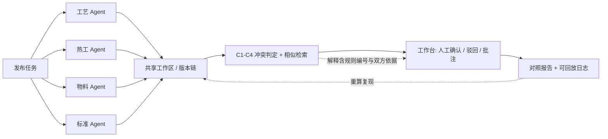

# 本科生毕业设计（论文）开题报告

**学　　校**：中南大学
**正式题名**：面向冶金工程设计任务的多智能体协同原型系统
**副 定 位**：工作台为人机界面；多角色智能体协同；挑战
**学　　院**：【待补】
**专　　业**：计算机（本科）
**学生姓名**：【待填】
**学　　号**：【待填】
**指导教师**：黎方正
**日　　期**：【待填】
**版　　本**：优化版 v2.0（在指导组示范稿基础上补全，正文可直接提交；附录 B 为教师核对用，提交时可删）

**题名口径说明**：原题 9「工艺设计协同工作台 + AI 辅助冲突/相似方案提示」降为子系统/界面层描述，不再作为全文总题；全文总题以「面向冶金工程设计任务的多智能体协同原型系统」为准。

---

## 纲领：开题三问与书面回答

指导组要求开题时钉死三问，并在研究内容与验收中可追踪回答。示范稿提出了三问但未给出答案，本版在此逐条正面作答，作为全文纲领；第三章 3.3 给出三问与研究内容、验收条款的追踪表。

| 三问 | 书面回答（锁定口径） |
|---|---|
| ① 各 Agent 的输入与输出分别是什么 | 输入＝任务书片段、共享工作区当前版本快照、该角色可检索的条款/规则库、以及上一回合的冲突与待定项清单；输出＝一份**结构化工件 artifact**（含参数表、依据条款、版本号、模型元信息），落盘为 JSON，而非一段自由文本对话。四个角色（工艺、热工、物料、标准）各有独立的输入视图与工件模板，不得只换提示词人设。 |
| ② 冲突与待定项如何被发现，并如何交由人或仲裁处理 | 冲突由**类型化规则 C1–C4** 在结构化参数表上计算得出（见 4.3），不依赖模型自述；每条冲突输出「命中规则编号 + 双方参数与依据条款 + 版本」。处置统一交**工作台上的真人**做确认 / 驳回 / 批注；系统可给确定性优先级（标准 > 工艺 > 热工 > 物料）作为**建议**，但不设「仲裁 Agent」，以保证协商链路完整可回放。 |
| ③ 用哪一套（或哪几套）样例工程证明闭环成立 | 用 2 套虚构、结构完整的冶金设计样例任务做主实验，第 3 套做泛化说明；每套含任务书、四类角色工件模板、≥12 条人工埋点冲突（C1/C2/C3 各 ≥4）、≥6 组相似方案对及 `golden.json` 标准答案。以「冲突发现率 / 误报率 / 人工负担 / 重跑一致率」对三组编排做对照，证明「提案—冲突/相似提示—人工确认—对照报告」闭环成立。 |

**可证伪的研究问题**：在结构化样例冶金设计任务上，采用「角色化多智能体提案 + 类型化冲突检测 + 人在回路确认」的协同编排，是否比单 Agent 串行与纯人工模板**发现更多预置冲突**（冲突发现率更高），且**不显著增加人工负担**（人工修改次数与确认回合数不显著上升）？

---

## 一、选题依据与意义

### 1.1 背景

随着人工智能辅助工业与工程设计逐步进入工程教育与原型研发场景，设计活动正从单点工具调用转向人机协同的流程化作业。冶金工程设计通常涉及工艺、热工、物料与标准等多专业并行推进，**版本并行、约束交叉与冲突发现滞后**，是当前协同不足的突出矛盾：某一专业修改后的参数往往要到评审会上才被其他专业发现不相容，而此时版本已分叉、依据已散失。

多智能体技术为「多角色并行提案 + 自动发现交叉约束」提供了新的可能，但也带来新的风险：若各 Agent 只是换人设的自由文本生成，冲突由模型自述、结果不可复现，则系统退化为演示界面，无法作为工程证据。因此本课题把**可计算、可复现、可证伪**作为立题前提，而非把「跑出一个多 Agent 对话」当作目标。

### 1.2 问题界定

本课题以「多智能体分工完成样例冶金设计任务」为切口，建设面向冶金工程设计任务的多智能体协同原型系统：以工作台作为人机界面，组织多角色智能体在共享工作区中提出设计片段，对冲突与相似方案给出可解释提示，并经人工确认形成对照报告。

研究对象是**设计协作流程本身**（角色协议、冲突判定、人工确认、证据留存），不是冶金机理、不是工艺优化、不是出图。样例任务虚构但结构完整，用于承载流程验证。

### 1.3 定位边界

本课题定位为**可运行的教学/科研原型与过程证据**，不声称替代专业设计院流程，也不以真实工厂投运为目标。题名中的「系统」指可复现的原型系统，不指工业级平台。

### 1.4 意义

- **方法意义**：把「多智能体协同是否有效」从一个演示问题变成一个可用评测集判定的实验问题，为本科阶段的 LLM 应用类课题提供可复制的证据规范。
- **教学意义**：与课程群「筑基—赋能—跃升」叙事一致，本课题训练的是协议设计、评测集构造与责任边界论证能力，即 AI 时代最稀缺的「能把智能体产出变成可核验交付物」的工程能力。
- **工程意义**：共享工作区 + 版本对照 + 可解释提示 + 人工确认的组合，可迁移到其他多专业协同设计场景。

---

## 二、国内外研究现状

> **文献说明**：本节按五个方向给出可核对的检索方向与评述框架，具体文献条目【待补】。学生须按学院格式补全 ≥15 篇真实文献，**禁止编造 DOI、卷期、页码或伪引文**；每条入选文献须先核对来源再写入第十节正式列表。

### 2.1 多智能体协同与角色协议

已有工作围绕角色分工、协商协议与共享状态展开：一类以对话式角色扮演组织多 Agent 回合（角色设定 + 轮流发言 + 汇总），一类以编排图/状态机显式定义节点与转移，还有一类以消息总线解耦各 Agent。三者共同为「多角色提出片段—协商冲突」提供方法参照，但多数工作以通用任务（代码生成、问答、写作）为评测场景，**少有把输出约束为结构化工程工件、并以预置冲突集做召回评测**的做法。本课题采用「显式编排 + 结构化工件」路线，回避纯对话式协同中输出不可比、不可回放的问题。

检索方向：多智能体协作框架与角色协议、Agent 编排/状态机、工具调用编排、共享状态与黑板模型。

### 2.2 人在回路与人工确认

人在回路（human-in-the-loop）研究强调在关键决策点保留人类否决权，并把人工反馈记录为可审计数据。工程设计场景下，人对冲突的确认/驳回本身即是高价值标注。本课题把人工确认设为**主路径必经环节**而非可选开关，并要求保留确认动作、批注与前后版本快照，使「人做了什么」可单独成证。

检索方向：人在回路机器学习、AI 辅助决策的人机责任边界、可审计交互日志、主动学习与人工反馈留痕。

### 2.3 工程设计协同与 PLM 的一致性维护

工业界强调版本管理、权限与变更流程；学术侧讨论多专业并行下的一致性维护、变更传播与约束满足。本课题**只吸收其「共享工作区 + 版本对照」思想**，不实现完整商业 PLM（不实现权限体系、审批流引擎、BOM 管理）。把「版本」降维为工件文件 + parent_version 指针，是本课题能在本科工作量内落地的关键取舍。

检索方向：产品生命周期管理基础概念、并行工程与一致性维护、设计变更传播、多专业协同设计模型。

### 2.4 版本差异、冲突检测与相似方案检索

软件工程与文档协同中的差异比较、冲突标注（如同键异值、区间不相交、约束互斥）可迁移到**设计片段的结构化对照**；案例推理（CBR）与相似检索可对历史或并行方案做提示。已有做法多面向代码或文本，工程参数表上的类型化冲突判定仍需自行定义。本课题据此给出 C1–C4 规则集（见 4.3），并要求提示须可解释、可人工否决。

检索方向：结构化差异比较、约束冲突检测、案例推理与设计案例检索、语义相似度与可解释检索。

### 2.5 可解释提示与对照实验设计

可解释性研究区分「模型自述式解释」与「证据可回溯式解释」。本课题明确采用后者：解释 = 命中规则编号 + 双方参数与依据条款 + 版本快照，可在不调用模型的情况下重算复现。对照实验设计方面，AI 应用类课题常见缺陷是只比「有无 AI」，不控制模型、预算与评测集，导致结论不可归因；本课题据此设置三组编排与公平性约束（见 5.3）。

检索方向：可解释 AI 与证据回溯、LLM 应用评测基准、消融与对照实验设计、可复现性工程实践。

### 2.6 现状评述与本科课题空间

综合来看，**把多智能体角色协议、工作台人机界面与可解释冲突/相似提示结合，并在虚构但结构完整的冶金样例上跑通可评测闭环**，仍有明确的本科课题空间：技术门槛不依赖真实工业系统与专有数据，工作量可通过样例规模调节，而创新性落在协同机制与证据规范上，不落在算力或机理突破上。

---

## 三、研究目标、内容与关键问题

### 3.1 总目标

交付一个**可按 README 运行、结果可复现**的多智能体协同原型，覆盖主路径「发布任务 → 多 Agent 出片段 → 冲突/相似提示 → 人工确认 → 对照报告」，并至少形成 ≥1 组「多智能体 vs 单 Agent/纯人工」对照用例、≥3 个可解释用例、以及完整的可回放日志与对照报告。

### 3.2 研究内容

| 编号 | 内容 | 关键产出 | 回应 |
|---|---|---|---|
| R1 | 角色智能体与协议 | 工艺/热工/物料/标准四角色的职责边界、输入视图、工件 schema、消息与交互协议；各 Agent 独立输入输出与独立日志 | 三问① |
| R2 | 共享工作区、版本与待定项 | 工件版本历史（parent_version 链）、待定项看板、每回合 JSONL 落盘、录制回放 fixture | 三问② |
| R3 | 冲突与相似的可解释提示 | C1–C4 类型化规则集、相似检索 Top-k、结构化解释输出模板；禁止模型自述式黑盒演示 | 三问② |
| R4 | 人工确认闭环 | 工作台确认/驳回/批注接口、处置记录、对照报告生成器；不设仲裁 Agent | 三问② |
| R5 | 样例工程与评测集 | 2–3 套虚构、结构完整的样例任务 + golden.json 标准答案 + 三组对照实验 | 三问③ |

五项内容均**不要求真实工厂数据、不要求真实出图、不要求 CAE 计算**。

### 3.3 三问—内容—验收追踪表

| 开题三问 | 对应研究内容 | 对应验收条款 | 可追踪证据 |
|---|---|---|---|
| ① 各 Agent 的输入输出 | R1 | 阻断项②：少于 2 个角色 Agent，或仅换人设无独立输入输出与日志，即不通过 | 四份工件模板、每角色独立 JSONL 日志 |
| ② 冲突如何发现、交谁处理 | R2 / R3 / R4 | 阻断项③：无协商/冲突可回放记录；阻断项①：主路径断裂 | 冲突明细表、回放 fixture、人工确认记录 |
| ③ 用哪几套样例证明闭环 | R5 | 阻断项④：无 ≥1 组对照用例；阻断项⑤：把 CAE/DCS/真实出图/工业可用写成已完成 | golden.json、对照实验报告、红线专节 |

### 3.4 关键问题与难点

| 难点 | 说明 | 攻克路径 |
|---|---|---|
| D1 冲突的形式化 | 若冲突由 LLM 自由判断，则「可解释」退化为模型自述，且无 ground truth，所有指标失效 | 工件结构化 + C1–C4 规则集 + 人工埋点评测集；解释由规则与证据生成，不调用模型 |
| D2 可复现性 | 多 Agent 多回合 LLM 调用天然随机，与「按 README 跑通」「可回放」「对照可复现」直接冲突 | 固定模型版本与 temperature=0/seed、全量 JSONL、录制回放 fixture、mock_llm 离线兜底 |
| D3 对照的公平性 | 不控制模型与预算，结论会被质疑「只是多花了算力」 | 同样例、同基座、同 token/回合预算上限、同评测集、同评审者，只变编排方式 |

**其中 D1 与 D2 是本课题真正的隐形难点**：表面看是搭建多 Agent 演示，实际难度集中在评测体系与证据链设计。这也是本课题与「模型训练类」毕设在能力要求上的根本差别。

---

## 四、研究方法与技术路线

### 4.1 总体架构

采用「编排/消息总线 + 工作台 HMI + 版本对照 + Agent 工具（检索/规则）」四层架构。智能体侧按角色协议生成结构化工件并调用检索/规则工具；工作台侧负责任务发布、待定项与确认操作；对照模块负责版本差异与冲突/相似呈现；证据层负责全量日志与回放。

| 层 | 职责 | 关键约束 |
|---|---|---|
| A 角色 Agent 层 | 四角色按模板产出工件，调用条款/规则检索工具 | 输出必须落盘 JSON；角色 ≥2 且各有独立输入输出与日志 |
| B 编排与消息层 | 组织回合顺序、广播版本快照与冲突清单 | 回合可编号、消息可序列化；不引入隐式 LLM 仲裁 |
| C 工件与版本层 | 工件存储、parent_version 链、待定项看板、C1–C4 判定 | 冲突判定为确定性计算，与模型调用解耦 |
| D 工作台与证据层 | 人工确认/驳回/批注、对照报告、JSONL 日志、replay fixture | 人工动作留痕；报告可由原始工件重算复现 |

### 4.2 工件 schema 与共享工作区

所有 Agent 输出必须落盘为结构化工件，不得只存在于对话上下文中：

```
artifact = {
  task_id, role, artifact_id, version, parent_version,
  params: [ { key, unit, value, range: [low, high], source_role, clause_ref } ],
  rationale,              // 依据：条款号 / 检索片段 / 规则编号
  created_at,
  llm_meta                // model, version, temperature, seed, prompt_hash
}
```

`clause_ref` 指向人工预置的条款库条目（可为虚构条款编号，但须可核对），`rationale` 记录依据来源。共享工作区即一组按 `artifact_id + version` 组织的文件，版本链由 `parent_version` 显式给出，避免依赖内存状态。

### 4.3 冲突类型化定义（C1–C4）

| 编号 | 类型 | 判定条件 | 处置 |
|---|---|---|---|
| C1 | 同键异值 | 同一 key 被不同角色给出不同 value，且超出约定容差 | 生成冲突项，附双方工件与依据，交人工确认 |
| C2 | 区间不相交 | 两角色对同一参数的 range 交集为空 | 同上 |
| C3 | 条款互斥 | 双方 clause_ref 指向人工预置的互斥条款对 | 同上 |
| C4 | 口径或单位不一致 | unit 或 key 语义不同且未完成换算 | 记为「待定项」，不判冲突，先要求澄清 |

**冲突判定全部为确定性规则计算**，与 LLM 调用解耦：给定同一组工件，不调用模型也能重算出完全相同的冲突集合。这是「可解释」「可回放」「重跑一致率」三项要求共同的前提。

### 4.4 相似提示与可解释输出

相似提示对 `params` 做字段 Jaccard 或参数向量距离，取 Top-k 返回，并附「命中字段 + 双方依据」。解释输出采用固定模板，禁止自由文本自述：

```
冲突 C2 @ 参数 T_kiln
  热工角色: [1350, 1400]   依据 H-07   工件 A-热工-v2
  标准角色: [<= 1300]      依据 S-03   工件 A-标准-v1
  判定: 区间交集为空 -> 命中规则 C2
  处置: 交人工确认（确认 / 驳回 / 批注），不设仲裁 Agent
```

相似提示须可人工否决；被否决的提示连同理由一并记入日志，作为误报率统计与可解释用例素材。

### 4.5 仲裁机制

**仲裁 = 工作台上的真人**。系统可提供确定性优先级（标准 > 工艺 > 热工 > 物料）作为处置建议，但该建议只是排序，不代替人的确认动作；**不设仲裁 Agent**，因为 LLM 仲裁会引入无法完整回放的隐式决策，直接顶到验收阻断项③。

### 4.6 主路径（固定）

| 步骤 | 环节 | 输入 | 输出 | 落盘证据 |
|---|---|---|---|---|
| 1 | 发布任务 | 任务书、样例配置 | 任务实例、角色分配 | task.json |
| 2 | 多 Agent 出片段 | 版本快照 + 冲突清单 | ≥2 份角色工件 | artifacts/*.json + 回合日志 |
| 3 | 冲突/相似提示 | 全部工件 | 类型化冲突表 + Top-k 相似 | conflicts.json + 解释文本 |
| 4 | 人工确认 | 冲突表 | 确认/驳回/批注记录 | decisions.jsonl |
| 5 | 对照报告 | 以上全部 | 版本对照与处置报告 | report.md / report.html |

任一环节缺失即视为主路径断裂，与验收阻断项①对齐。



技术路线按「先固化工件与评测集 → 再接单 Agent → 再扩多角色 → 最后做对照与回放」的顺序推进：**评测集先行**，避免先写系统再凑用例。

### 4.7 可复现与离线兜底

| 措施 | 具体做法 |
|---|---|
| 固定生成条件 | 记录并固定 model + version；temperature=0；固定 seed；记录 prompt_hash |
| 全量留痕 | 每回合 prompt、模型输出、工具调用、工件版本、人工动作写入 JSONL |
| 录制回放 | `replay/` 保存一次真实运行的完整 fixture（含模型应答），可脱网重放 |
| 离线兜底 | `mock_llm` 开关：以固定应答或本地小模型替代商用 API，保证主路径仍可跑通 |
| 双命令 README | `run`（在线真实调用）与 `replay`（离线回放）两条命令都必须跑通主路径 |
| 重算校验 | 对照报告中的每条冲突，须能从 artifacts 原始工件在不调用模型的情况下重算得出 |

---

## 五、实验设计与评价指标

### 5.1 样例工程最小规格

| 项 | 规格 |
|---|---|
| 任务书 | 每套 1 份，含设计目标、边界条件、验收约束 |
| 角色工件模板 | 工艺/热工/物料/标准 4 类，字段固定，与 artifact schema 一致 |
| 参数条目 | 每套 ≥20 条，覆盖四类角色 |
| 埋点冲突 | 每套 ≥12 条，C1/C2/C3 各 ≥4，写入 golden.json |
| 相似方案对 | 每套 ≥6 组，标注相似等级与命中字段 |
| 标准答案 | golden.json：冲突清单、类型、涉及工件、建议处置 |
| 样例数量 | 2 套用于主对照实验，第 3 套用于泛化说明与过拟合检查 |
| 数据来源 | 全部虚构，不接真实工厂数据，不做真实出图 |

### 5.2 评测集构造

先由人工在样例中**埋点**已知冲突与相似对，形成 golden.json；再让各编排方式独立跑同一任务，以其输出的冲突集合与标准答案比对。埋点须覆盖三类规则，并特意设置若干「看似冲突实则口径不同」的 C4 情形，用于检验误报。

### 5.3 对照实验设计

| 组别 | 编排方式 | 说明 |
|---|---|---|
| G1 | 多角色协同（本系统） | 四角色并行提案 + 类型化冲突检测 + 人工确认 |
| G2 | 单 Agent 串行 | 同一模型依次扮演四角色，串行产出工件，同一冲突判定模块 |
| G3 | 纯人工模板 | 结构化表单人工填写，无 LLM 生成，同一冲突判定模块 |

**公平性控制**：同一套样例、同一基座模型、同一 token/回合预算上限、同一评测集 golden.json、同一人工评审者；三组只变「编排方式」。冲突判定模块三组共用，确保差异只来自提案与协同环节，而非判定口径。

### 5.4 评价指标

| 指标 | 定义 | 用途 |
|---|---|---|
| 冲突发现率 | 检出的预置冲突数 / 预置冲突总数，按 C1/C2/C3 分列 | 主要有效性指标 |
| 误报率 | 非预置冲突被报出的条数 / 总报出条数 | 检验 C4 与规则严谨性 |
| 人工负担 | 人工修改次数、确认回合数、端到端耗时 | 检验「不显著增加负担」 |
| 提示采纳率 | 人工采纳的提示数 / 提示总数 | 可解释性间接指标 |
| 相似提示命中率 | Top-k 中命中预置相似对的组数 / 预置相似对总数 | 相似检索有效性 |
| 重跑一致率 | 同输入重跑，冲突集合与对照报告一致的比例 | 可复现性硬指标 |

结论表述必须克制：若 G1 在发现率上优于 G2/G3 且人工负担不显著上升，则支持协同编排有效；**若差异不显著，须如实报告并分析原因，不得强行宣称优势**。

### 5.5 可解释用例集合（≥3）

| 用例 | 覆盖 | 验收要点 |
|---|---|---|
| E1 | C1 同键异值 | 解释含双方 value、容差、命中规则、工件版本 |
| E2 | C2 区间不相交 | 解释含双方区间、交集为空的计算、依据条款 |
| E3 | C3 条款互斥 | 解释含互斥条款对编号与预置互斥表条目 |
| E4（建议） | C4 误报被人工驳回 | 记录驳回理由，用于误报率与边界讨论 |

每个用例须能从原始工件重算复现，并附人工确认记录，禁止「黑盒演示」式通过验收。

---

## 六、进度安排

> 具体日期【待学院节点回填】；下表周次为建议排布，阶段目标与交付物为锁定项。

| 阶段 | 建议周次 | 阶段目标 | 交付物 | 判定 |
|---|---|---|---|---|
| 开题阶段 | 第 1–3 周 | 钉死角色划分、交互协议与样例工程选型；书面回答开题三问；完成开题报告修订 | 修订版开题报告、artifact schema、样例规格表 | 三问有书面答案，协议与 schema 定稿 |
| 评测集先行 | 第 4–6 周 | 完成 2 套样例、埋点冲突与 golden.json；实现 C1–C4 判定与解释模板 | 样例包、规则模块、单元测试 | 不调用模型即可重算出标准答案 |
| 中期阶段 | 第 7–9 周 | 至少两个角色 Agent 跑通「提案—冲突—确认」，保留日志与可回放记录 | 原型 v0.5、JSONL 日志、回放 fixture | 对应中期检查；阻断项③提前自查 |
| 实现阶段 | 第 10–14 周 | 完成可运行原型与 README；实现 ≥3 个可解释用例；完成 ≥1 组三组对照 | 原型 v1.0、README（run/replay）、对照实验记录 | 主路径 5 步全部可跑通 |
| 论文与答辩 | 第 15–18 周 | 整理角色权限与流程说明、对照报告、红线专节；完成论文与答辩 | 论文、答辩材料、红线三分表 | 呼应阻断项⑤，专节写清责任边界 |

---

## 七、预期成果与验收

### 7.1 预期成果

1. 可按 README 运行的原型系统（含 `run` 与 `replay` 两条主路径命令）；
2. 角色权限与流程说明（四角色职责、输入输出、协议）；
3. 版本/冲突对照报告与可回放日志；
4. ≥3 个可解释用例（含解释模板与重算记录）；
5. ≥1 组「多智能体 vs 单 Agent/纯人工」对照用例及指标表；
6. 样例工程包（2–3 套 + golden.json）；
7. 项目 README 与关键日志/回放材料；
8. 论文中的红线专节与「多智能体做了什么 / 人做了什么 / 红线没做什么」三分表。

### 7.2 验收阻断项（指导组锁定，原样保留）

**出现任一项即验收不通过：**

1. 原型按 README 跑不通，或「发布任务→多Agent出片段→冲突/相似提示→人工确认→对照报告」主路径断；
2. `<2` 个角色 Agent，或仅换人设无独立输入输出与日志；
3. 无协商/冲突可回放记录；
4. 无 ≥1 组有多智能体 vs 单 Agent/纯人工的对照用例；
5. 把 CAE/DCS/真实出图或工业可用效果写成已完成。

### 7.3 主路径判定表

| 判定点 | 通过条件 | 证据位置 |
|---|---|---|
| 发布任务 | task.json 生成，角色分配明确 | tasks/ |
| 多 Agent 出片段 | ≥2 个角色各产出独立工件，日志可区分 | artifacts/ + logs/ |
| 冲突/相似提示 | 输出含规则编号、双方参数与依据 | conflicts.json |
| 人工确认 | 每条冲突有确认/驳回/批注记录 | decisions.jsonl |
| 对照报告 | 报告每条冲突可由原始工件重算复现 | report.md + replay/ |

---

## 八、可行性分析与风险对策

### 8.1 可行性

| 维度 | 判断 |
|---|---|
| 技术可行性 | 编排、结构化工件、规则判定、Web 工作台均为成熟工程手段；不涉及模型训练与机理建模 |
| 数据可行性 | 样例与条款库全部虚构且结构完整，无需真实工厂数据、无需审批与脱敏 |
| 条件可行性 | 笔记本即可开发；通过 mock_llm 与 replay 保证无网络、无 API 经费时仍能跑通主路径 |
| 能力匹配 | 适合协议设计、工程化与论证能力较强、能耐心构造评测集的学生；不适合以模型训练为主攻方向的学生 |
| 工作量可伸缩 | 下限：规则 Agent + 2 套样例 + 录制回放；上限：RAG 条款依据、更细冲突类型、更完整量化对照 |

### 8.2 风险与对策

| 风险 | 影响 | 对策 |
|---|---|---|
| LLM 输出不确定，答辩现场跑不出同样结果 | 触发阻断项①③ | 固定 temperature=0/seed、全量 JSONL、replay fixture、答辩演示走 replay |
| 商用 API 费用/限流/断网 | 原型跑不通 | mock_llm 兜底、限制回合预算、README 双命令 |
| 范围膨胀，想做 CAE/真实出图/工业效果 | 触发阻断项⑤，且工作量失控 | 开题即锁定红线；样例虚构；中期检查复核范围 |
| 样例与埋点主观，评测集被质疑 | 结论不可信 | golden.json 公开、埋点按 C1/C2/C3 分层、第 3 套样例做泛化检查 |
| 对照不公平，被质疑「只是多花算力」 | 结论不可归因 | 5.3 公平性控制；三组共用判定模块 |
| 格式不合学院要求被退回 | 影响开题节点 | ≥15 篇真实文献按学院格式、标题层级与页码目录、正文与附录 B 分离 |

---

## 九、创新点与红线

### 9.1 创新点

1. **面向冶金工程设计样例任务的多智能体协同机制**：以工作台为人机界面，把多角色提案、类型化冲突/相似可解释提示与人工确认闭环组织为可运行原型；
2. **冲突判定的确定性化**：把「可解释」从模型自述改为「规则编号 + 双方参数 + 依据条款 + 版本」的证据回溯，使解释可在不调用模型的情况下重算；
3. **面向 LLM 应用类课题的证据规范**：预置冲突评测集 + 三组公平对照 + 录制回放，把「AI 有没有用」变成可证伪的实验问题。

创新表述克制为「协同原型与过程方法」，**不夸大为冶金机理突破或产线级系统**。

### 9.2 红线

- 不做真实 CAE、中试或 DCS；
- 不提交真实工厂出图，不使用未审批的真实工厂数据；
- 不声称工业可用、不声称可替代专业设计流程；
- 不编造文献、DOI、卷期或实验数据；
- 不设隐式 LLM 仲裁，不把模型自述当作可解释证据。

论文与答辩材料须**专节**写清「多智能体做了什么 / 人做了什么 / 红线没做什么」。

### 9.3 三分责任表（论文与答辩必备）

| 多智能体做了什么 | 人做了什么 | 明确没做什么 |
|---|---|---|
| 按角色协议产出结构化设计片段工件；调用条款/规则检索给出依据 | 编写任务书与条款库；构造样例与埋点评测集；定义 C1–C4 规则 | 未做真实 CAE 计算、中试或 DCS 接入 |
| 并行提出可能不相容的参数，形成待比较的方案集 | 对每条冲突做确认/驳回/批注；对相似提示做否决 | 未做真实工厂出图，未使用真实生产数据 |
| 输出可由规则重算的解释条目与版本链 | 审定对照报告结论，判定协同是否真的有效 | 未声称工业可用，未替代专业设计流程 |
| 全程留痕（prompt、输出、工具调用、工件版本） | 复核回放一致性，签署验收结论 | 未让模型充当仲裁者，未把模型自述当证据 |

---

## 十、参考文献与补齐要求

**正式参考文献条目【待补】，须 ≥15 篇，按学院格式著录。** 学生按下列方向检索与阅读，每条入选文献须先核对来源（出版社/会议/期刊/官方仓库/权威综述）后再写入，**禁止编造 DOI、卷期、页码或伪引文**。

| 序号 | 检索方向 | 建议关键词 | 来源类型 |
|---|---|---|---|
| 1 | 多智能体协同与角色协议 | multi-agent collaboration, role protocol, agent orchestration | 综述、框架官方文档、顶会论文 |
| 2 | 人在回路与人工确认 | human-in-the-loop, human oversight, audit trail | 综述、人机交互研究 |
| 3 | 工程设计协同 / PLM 基础 | PLM, concurrent engineering, consistency maintenance | 教材、标准、行业综述 |
| 4 | 版本差异与冲突检测 | structured diff, constraint conflict detection | 软件工程 / 协同编辑论文 |
| 5 | 相似方案与案例检索 | case-based reasoning, design case retrieval, similarity | 设计方法学论文 |
| 6 | 可解释提示与证据回溯 | explainable AI, evidence-grounded explanation | 可解释性综述 |
| 7 | LLM 应用评测与对照实验 | LLM evaluation benchmark, ablation study | 评测基准论文 |
| 8 | 可复现性工程实践 | reproducibility, deterministic replay, logging | 工程实践文献 |

**著录格式示范（占位，不得照抄为真实文献）**：

```
[1] 作者. 题名[文献类型标识]. 出处, 年份, 卷(期): 起止页码. （须核对后填写）
[2] 作者. 题名. 会议名称, 年份: 页码. （须核对后填写）
```

本项目此前所有开题报告均遵循「只给检索方向、严禁编造引文」的约定，本版保持一致。

---

## 附录 A：交付目录结构与 README 约定

```
project/
  README.md                 # run / replay 两条命令，主路径与验收自查表
  tasks/                    # task.json，样例任务书
  schema/artifact.json      # 工件 schema 与四角色模板
  rules/conflicts_c1_c4.md  # 冲突规则集、互斥条款表
  samples/                  # 2-3 套样例 + golden.json
  agents/                   # 四角色实现 + mock_llm
  workbench/                # 工作台 HMI：确认/驳回/批注
  artifacts/                # 各版本工件（parent_version 链）
  logs/                     # 每回合 JSONL：prompt/输出/工具调用/人工动作
  replay/                   # 一次真实运行的完整 fixture
  report/                   # 版本与冲突对照报告、指标表
```

README 须写明：环境依赖、如何获取（或不获取）模型密钥、如何运行 `run`、如何离线运行 `replay`、主路径五步自查表、以及 5 条验收阻断项的自查清单。

---

## 附录 B：本版相对示范稿的调整说明（教师核对用，正式提交可删）

| # | 示范稿状态 | 本版处理 | 依据 |
|---|---|---|---|
| 1 | 只提出开题三问，未给答案 | 新增「纲领：开题三问与书面回答」，逐条正面作答并锁定口径 | 分析报告：三问须可追踪，答案不能空 |
| 2 | 「冲突」无可计算定义 | 新增 4.2 工件 schema、4.3 冲突 C1–C4、4.4 解释输出模板 | 硬伤① |
| 3 | 「仲裁」含糊 | 4.5 明确仲裁＝真人，仅给确定性优先级建议，不设仲裁 Agent | 硬伤④ |
| 4 | 样例仅「2–3 套虚构、结构完整」 | 5.1 给出最小规格表、golden.json、埋点要求 | 硬伤③ |
| 5 | 对照只有数量、无指标 | 新增第五章：三组对照、公平性控制、6 项指标、≥3 可解释用例 | 硬伤⑤ |
| 6 | 未提可复现 | 4.7 固定生成条件、JSONL、replay、mock_llm、双命令 README | 硬伤② |
| 7 | 研究现状四段全是方向名 + 待补 | 第二章改写为五方向实质评述 + 检索方向，仍不编造引文 | 硬伤⑥ |
| 8 | 缺难点/可行性/路线图 | 3.4 关键难点表、4.1 四层架构与 mermaid 路线图、第八章可行性与风险表 | 硬伤⑦ |
| 9 | 无表格、无标题样式、10 处待回填 | 全文 20+ 表格，标题层级完整；封面与进度日期保留占位并标明 | 体例 |
| 10 | 题名偏「系统」，无可证伪问题 | 纲领节补一句可证伪研究问题 | 建议补⑫ |
| 11 | 「三分」要求只在正文提一句 | 9.3 增加三分责任表，可直接进论文与答辩 | 建议补⑪ |
| 12 | 未写成本/依赖 | 8.1 条件可行性 + 8.2 风险表 | 硬伤⑧ |
| 13 | 参考文献线索节空 | 第十章 8 类检索方向 + 格式示范 + ≥15 篇要求，明确严禁编造 | 硬伤⑥ |

**完整保留**：正式题名、副定位、原题 9 降级说明、开题三问、主路径五步、5 条验收阻断项（原样）、红线四条、以及「论文与答辩须专节写清三分」的要求。

---

*本版为优化稿，正文可直接提交；封面【待补/待填】字段、进度日期与参考文献须由学生按学院要求回填。全文未编造任何文献条目与实验数据。*
